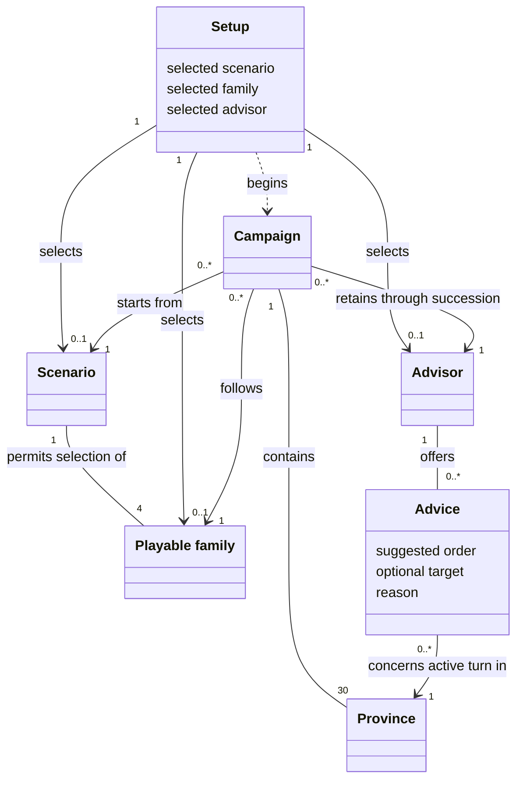

# 16. New game & advisors

**Status:** DRAFT

## Description

Begin on a title screen, choose a scenario, family, and advisor, then enter a fresh campaign. During play, consult the advisor for a concrete suggestion about the current province.

After a campaign ends, return to the title to begin another. Mid-campaign quitting remains part of [Options / settings](../ROADMAP.md#18-options--settings).

## Glossary

| Term | Meaning |
| --- | --- |
| Scenario | A fixed starting situation: date, families, characters, provinces, resources, Gems, and hire pools. |
| Playable family | A family permitted as the player's house in that scenario; active rival houses are not necessarily playable. |
| Setup | The player's choices before a campaign exists. Backtracking changes these choices without changing a world. |
| Advisor | A named counsellor chosen for the campaign, separate from its generals and rulers. |
| Advice | One suggested next action, its province and optional target, and the reason for suggesting it. It confers no bonus and executes no order. |
| Campaign | One playthrough from the perspective of the player's chosen family, continuing through succession until victory or defeat. |
| Province | A territory whose ownership, resources, and development determine the orders available there. |

## Functionality

### Title and options

- Open on the title screen with New Game and Options.
- Options offers an All sounds switch and separate Music and SFX controls, each with an on/off switch and a 0–100% volume slider. Switching a channel off keeps its volume. All sounds disables the channel controls while retaining their choices.
- The SFX slider previews a click when released. The chosen settings carry into the campaign.

### Starting a campaign

- Do not advance time until setup is confirmed. The campaign begins from the confirmed scenario and family.
- Follow Scenario → Family → Advisor → Begin campaign. Allow Back at each step; returning from Scenario goes to the title.
- Offer all four scenarios using their canonical names and dates from scenario configuration. Show a short account of their starting situation.
- Preview each scenario's political map. Its ownership, rulers, resources, rosters, and Gems must match the campaign's starting situation.
- Offer only the scenario's playable families, following [Appendix B §B.4](../spec/appendix-b-character-and-scenario-data.md#b4-playable-families-and-difficulty-notes):

| Scenario | Playable families |
| --- | --- |
| The Fractured Oath | Alderwyn, Stormmere, Emberholt, Thornvale |
| Embers of Rebellion | Stormmere, Alderwyn, Redwake, Greyfen |
| The Western Schism | Stormmere, Alderwyn, Duskerran, Valecross |
| Gemstorm | Stormmere, Alderwyn, Sunhallow, Blackharbor |

- Changing scenario clears the family choice. Backtracking within the same scenario retains valid choices. Require an explicit family and advisor selection before Begin campaign is enabled.
- Offer Orraven the Chronicler, Brannoc the Marshal, Vesha the Seer, and Quillon the Jester. Display a portrait, name, and short sample of their voice.
- The final advisor screen also summarizes the scenario and family. Begin campaign commits all three choices once; repeated clicks cannot create multiple campaigns.
- Start an independent campaign in the scenario's January, following the [monthly turn sequence](./02-the-monthly-turn.md); earlier rival turns may run before the first player turn. Browsing setup does not advance time or change the starting situation.
- After an ending, retain Inspect map and add New Game, which returns to the title. The previous campaign cannot affect subsequent play.

### Consulting an advisor

All four advisors share the same advice rules. Choosing one changes the portrait, name, and wording; it does not change recommendations, statistics, costs, success chances, or computer behavior.

- Show Advice beside province orders during an actionable human-controlled province turn. Advice concerns that active province, irrespective of a rival province currently being inspected.
- Consultation is free and optional. It neither consumes an order nor changes resources, time, goodwill, or the outcomes of subsequent actions and events.
- Show one recommendation and a short factual reason, with Close. The player returns to orders and chooses whether to act. Advice does not open or submit an order automatically.
- Use only information already available to the player. Unknown enemy troops, hidden loyalty, event chances, and undiscovered artifacts cannot influence recommendations.
- Repeated consultation of an unchanged situation returns the same recommendation. Advice reflects the current situation after an order changes it.
- Do not offer consultation during battle, mandatory reports or decisions, computer turns, or after the campaign ends. Entrusted provinces retain their existing computer control.

### Choosing advice

The original recommendation algorithm is undocumented. The following is a proposed remake rule, with no claim of exact reproduction:

1. Address an immediate shortfall: gold needed for approaching hired-unit upkeep or food needed for a documented supply obligation; suggest a legal affordable trade or transport from a friendly province when the active province can issue it.
2. Improve low loyalty when Give Food is legal and affordable.
3. Prepare a weakly defended frontier: recruit when affordable; otherwise improve Protection when affordable.
4. Expand into an adjacent neutral province when a legal troop movement can claim it without emptying the source garrison.
5. Improve Cultivation or Protection using the existing economy priorities and legal order limits.
6. Suggest passing the province's turn when no supported useful order is available.

Resolve equally suitable targets by province number. Military advice stops at frontier preparation and neutral expansion; it does not predict invasion victories. Recommend relief below 40 Loyalty, reinforcement below 100 troops on a hostile frontier, and frontier Protection below 50. These are initial balance values.

Every recommendation must satisfy the existing order's eligibility and affordability rules. Its reason names the observed need, for example low loyalty or an adjacent neutral province. Each advisor expresses that reason in their own voice. Quillon's wording must still make the suggested action and reason understandable.

## Use cases

### Change the starting situation

The player selects Emberholt in The Fractured Oath, then goes back and chooses Embers of Rebellion. Emberholt is no longer selected or offered. The player must choose one of that scenario's playable families before proceeding. Returning to the family screen without changing scenario retains the current choice.

### Ask for help while inspecting a rival

During a player province's turn, the player inspects a rival province and opens Advice. The recommendation names the active player province and uses only known facts. Closing the dialog leaves its orders available without spending its action.

### Decline a recommendation

The advisor suggests giving food to a province with low loyalty. The player closes the advice and spends food on a different legal order. A later consultation reflects the remaining food and never repeats an unaffordable recommendation.

### Begin again after defeat

The player loses their last province, acknowledges the ending, and inspects the final map. Choosing New Game returns to the title. Their next campaign begins with the chosen scenario's original territories and resources, without reports or consequences carried over from the defeat.

## UI

```text
┌─ Gemstorm ─────────────────────────────────┐
│                                            │
│                 GEMSTORM                   │
│                                            │
│               [ New Game ]                 │
│               [ Options  ]                 │
│                                            │
└────────────────────────────────────────────┘

┌─ New game · Family ──────────────────────────────┐
│  Choose Family                                   │
│  The Fractured Oath · Year 201                   │
│                                                  │
│  ┏━━━━━━━━━━┓ ┌──────────┐   <map preview with   │
│  ┃ [crest]  ┃ │ [crest]  │    starting crests;   │
│  ┃ Alderwyn ┃ │Stormmere │    chosen house's     │
│  ┗━━━━━━━━━━┛ └──────────┘    lands lit>         │
│  ┌──────────┐ ┌──────────┐                       │
│  │ [crest]  │ │ [crest]  │                       │
│  │Emberholt │ │Thornvale │                       │
│  └──────────┘ └──────────┘                       │
│                                                  │
│  [portrait]  Avar                                │
│              Age 19                              │
│              INT 82  WAR 87  CHA 76              │
│              4 vassals                           │
│                                                  │
│  [ Back ]                         [ Next ]       │
└──────────────────────────────────────────────────┘

┌─ New game · Advisor ─────────────────────────────┐
│  Choose Advisor                                  │
│  The Fractured Oath · Year 201 · Alderwyn        │
│                                                  │
│  ┏━━━━━━━━━━┓ ┌──────────┐   <map preview with   │
│  ┃[portrait]┃ │[portrait]│    chosen family's    │
│  ┃ Orraven  ┃ │ Brannoc  │    lands lit>         │
│  ┗━━━━━━━━━━┛ └──────────┘                       │
│  ┌──────────┐ ┌──────────┐                       │
│  │[portrait]│ │[portrait]│                       │
│  │  Vesha   │ │ Quillon  │                       │
│  └──────────┘ └──────────┘                       │
│                                                  │
│  [portrait]  Orraven                             │
│              the Chronicler                      │
│              “A wise ruler prepares for          │
│               tomorrow.”                         │
│                                                  │
│  [ Back ]                        [ Begin ]       │
└──────────────────────────────────────────────────┘

┌─ <Advisor name> ─────────────────────────┐
│  <Portrait>                              │
│  Give food to <active province>.         │
│  Its people need reassurance: loyalty    │
│  is low.                                 │
│                               [ Close ]  │
└──────────────────────────────────────────┘
```

The Scenario screen shows all four names, starting dates, and short introductions. Next opens the Family screen illustrated above. The Advisor screen offers four portraits with names. The selected advisor's portrait, title, and a sample saying appear below them; the map highlights the chosen family's provinces as the scenario/family summary. Begin starts the campaign.

Reuse the existing visual language and map geometry. The setup map shows starting ownership without orders or turn markers. Highlight the selected family's provinces on the map and display its ruler: portrait, name, age, INT, WAR, CHA, and number of vassals. Selection works by keyboard and pointer, with visible focus, accessible labels, and focus restored to Advice when its dialog closes. Escape follows Back in setup and closes optional advice.

### Title screen

The title shows an animated landscape behind the menu, with a gentle parallax that follows the mouse. All motion stops when the system's reduced-motion preference is set.

### Menu music

Play _The Crown of the Fallen Kingdom_ (`public/music/title.mp3`) across setup steps without restarting it. Browser autoplay may leave the initial title silent; the first pointer or keyboard activation starts the current screen's music when playback is permitted. Beginning the campaign switches to map music. Returning from a completed campaign switches to title music. Unavailable audio never blocks setup.

## Research

### Advisor differences

[TIDQ](https://gamefaqs.gamespot.com/snes/588352-gemfire/faqs/34164) and [Hartman](https://gamefaqs.gamespot.com/snes/588352-gemfire/faqs/31840) report equivalent advice with different wording. Use shared advice rules and four presentation styles. The [SNES manual, p.14](https://www.videogamemanual.com/snes/Gemfire%20%28USA%29.pdf#page=16) establishes setup selection and consultation beside the main commands; our UI exposes an Advice button there.

### Advice rules

Original messages cover hiring, supplies, development, defence, and rival invasions. The selection algorithm is unknown. Our priority order, visible-information limit, affordability guarantee, repeated response, and restriction to neutral expansion are remake choices. The initial relief and defence thresholds are balance choices. See the [SNES FAQ](https://gamefaqs.gamespot.com/snes/588352-gemfire/faqs/34164) for the original-game observations; exact advice rules remain unverified.

### Scenario data

Complete scenarios 2–4 using the local ROM records for ownership, resources, and hire pools, and the character roster for attributes, following the [source hierarchy](../spec/README.md#source-notes). Scenario 3 uses the documented Gweyn ruler correction, without giving Erven Tordin lineage. Character attributes follow the roster, including Pender’s Scenario-2 WAR of 92 and Gweyn’s Scenario-3 WAR of 58; ROM hire-pool names are normalized to the unit catalogue.

## Overview

- **Session**: lasts from launch to exit. It holds the title, the setup screens, Options, and the menu music.
- **Campaign**: one playthrough. It is built from the setup choices when the player confirms them, and discarded when it ends, so a new game never inherits anything from the last one.

## Domain model



## Flow


## Persistence

When [Save / load](../ROADMAP.md#17-save--load) is available, retain the scenario, player's family, and chosen advisor with the campaign's current situation. Resuming preserves the same counsellor through any succession and offers advice about the resumed situation. Browsing setup and past consultations need not survive between sessions.

## Tests

- Verify all four scenario definitions against the authoritative local records: 30 unique provinces, valid owners and governors, correct starting resources and hire pools, and coherent family, roster, and Gem references.
- Start every playable scenario/family combination; rival-only choices are unavailable. Confirm date, player identity, opening ownership, and resources restored to their scenario values on a second campaign.
- Backtracking retains valid choices; changing scenario clears the family choice. No turns or reports occur during setup, and repeated Begin campaign activation starts only one campaign.
- Advice for shortages, low loyalty, frontier preparation, and neutral movement always suggests an eligible, affordable action or passing. Equal situations produce the same recommendation; consultation leaves orders, resources, and subsequent event outcomes unaffected.
- Change only hidden enemy facts and confirm advice is unchanged. Every advisor recommends the same action and target for the same visible situation, with intelligible wording.
- Check opening reports and first player turns for families whose provinces occur later in turn order. Inspect a rival province and confirm Advice still concerns the active province.
- Complete setup using only the keyboard, then close Advice and confirm focus returns to its button. The title theme continues across setup and switches to map music at campaign start; unavailable audio does not prevent play.
- Finish one campaign and begin another. Confirm no repeated reports, skipped turns, overlapping music, or effects carried over from the prior campaign. Confirm the same advisor remains after succession and consultation is unavailable during mandatory decisions or after the ending.
