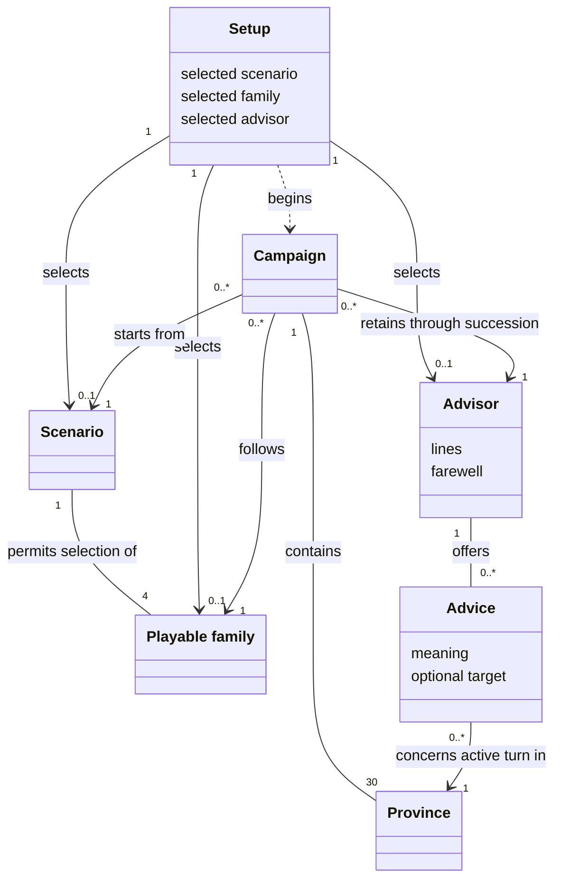
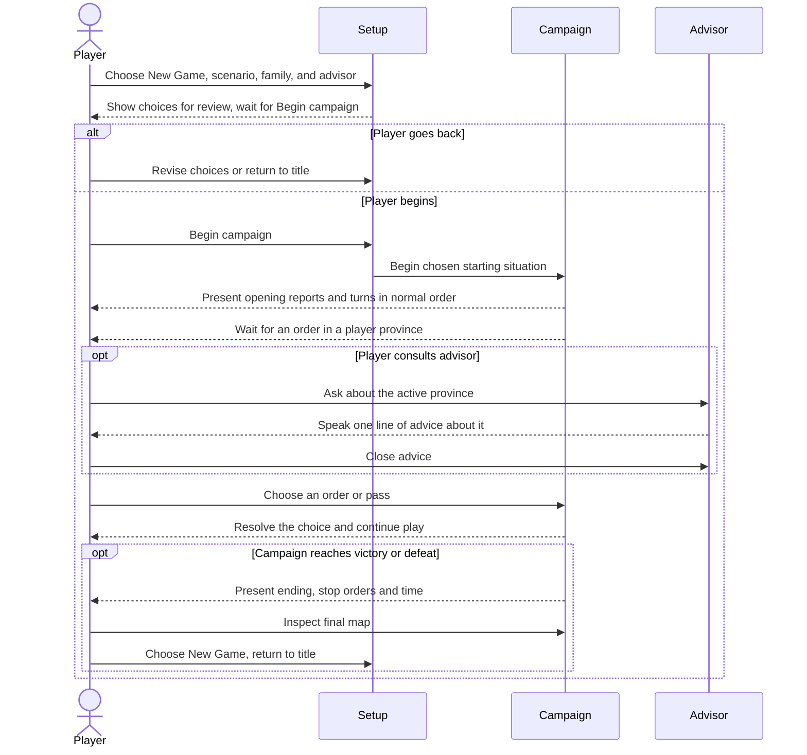

# 16. New game & advisors

**Status:** DRAFT

## Description

Begin on a title screen, choose a scenario, family, and advisor, then enter a fresh campaign. During play, consult the advisor for a word of counsel about the current province.

After a campaign ends, return to the title to begin another. Mid-campaign quitting remains part of [Options / settings](../ROADMAP.md#18-options--settings).

## Glossary

| Term | Meaning |
| --- | --- |
| Scenario | A fixed starting situation: date, families, characters, provinces, resources, Gems, and hire pools. |
| Playable family | A family permitted as the player's house in that scenario; active rival houses are not necessarily playable. |
| Setup | The player's choices before a campaign exists. Backtracking changes these choices without changing a world. |
| Advisor | A named counsellor chosen for the campaign, separate from its generals and rulers. The four differ in portrait, name, and voice, never in what they advise. |
| Advice | One line of counsel about the active province, voiced by the advisor. It points at a need; it confers no bonus and carries out no order. |
| Meaning | One of the fourteen things an advisor can say. Every advisor has their own wording for each. |
| Campaign | One playthrough from the perspective of the player's chosen family, continuing through succession until victory or defeat. |
| Province | A territory whose ownership, resources, and development determine the orders available there. |

## Functionality

### Title and options

- Open on the title screen with New Game and Options.
- Options offers an All sounds switch and separate Music and SFX controls, each with an on/off switch and a 0–100% volume slider. Switching a channel off keeps its volume. All sounds disables the channel controls while retaining their choices.
- The SFX slider previews a click when released. The chosen settings carry into the campaign.

### Starting a campaign

- Do not advance time until setup is confirmed. The campaign begins from the confirmed scenario and family.
- Follow Scenario → Family → Advisor → Begin campaign. Allow Back at each step; returning from Scenario goes to the title.
- Offer all four scenarios using their canonical names and dates from scenario configuration. Show a short account of their starting situation.
- Preview each scenario's political map. Its ownership, rulers, resources, rosters, and Gems must match the campaign's starting situation.
- Offer only the scenario's playable families, following [Appendix B §B.4](../spec/appendix-b-character-and-scenario-data.md#b4-playable-families-and-difficulty-notes):

| Scenario | Playable families |
| --- | --- |
| The Fractured Oath | Alderwyn, Stormmere, Emberholt, Thornvale |
| Embers of Rebellion | Stormmere, Alderwyn, Redwake, Greyfen |
| The Western Schism | Stormmere, Alderwyn, Duskerran, Valecross |
| Gemstorm | Stormmere, Alderwyn, Sunhallow, Blackharbor |

- Changing scenario resets the family choice to that scenario's first playable family. Backtracking within the same scenario retains valid choices. Each step opens with a choice already made (the first scenario, the first playable family, the first advisor), so Next and Begin campaign are always enabled.
- Offer Orraven the Chronicler, Brannoc the Marshal, Vesha the Seer, and Quillon the Jester. Display a portrait, name, and short sample of their voice.
- The final advisor screen also summarizes the scenario and family. Begin campaign commits all three choices once; repeated clicks cannot create multiple campaigns.
- Start an independent campaign in the scenario's January, following the [monthly turn sequence](./02-the-monthly-turn.md); earlier rival turns may run before the first player turn. Browsing setup does not advance time or change the starting situation.
- After an ending, retain Inspect map and add New Game, which returns to the title. The previous campaign cannot affect subsequent play.
- A victory ends with the advisor once more: their portrait and one closing line in their voice. A defeat has no advisor line.

### Consulting an advisor

All four advisors share the same advice rules. Choosing one changes the portrait, name, and wording; it does not change what is advised, statistics, costs, success chances, or computer behaviour.

- Show Advice as a small button with the advisor's portrait beside Skip Turn, which keeps most of the row, during an actionable, player-run province turn. Advice concerns that active province, irrespective of a rival province currently being inspected.
- Consultation is free and optional. It neither consumes an order nor changes resources, time, goodwill, or the outcomes of subsequent actions and events.
- Show the advisor's portrait and name and one line of advice in their voice, with Close. Advice never opens or carries out an order; the player returns to the orders and decides.
- Advice points at a need, not at a finished order. Only two lines name a province: the one urging an attack and the one pointing at an unclaimed neighbour.
- Advice is not checked against what the province can afford or legally do. An advisor may urge recruiting in a province without the Gold for it.
- Asking again may bring a different line when several apply; the advisor picks among them by chance each time.
- Do not offer consultation during battle, mandatory reports or decisions, computer turns, entrusted provinces, or after the campaign ends.

### Choosing advice

The rule follows the original game. It is separate from the computer houses' own judgement and uses different thresholds.

**1. Shortage comes first.** Compare the province's stores with its next quarterly upkeep:

- Gold needed: Cultivation ÷ 5 when a general is present, plus the cost of every hired Fifth Unit.
- Food needed: soldiers ÷ 10.

| Short of | Meaning |
| --- | --- |
| Gold and Food | Poor in both |
| Gold only | Find gold |
| Food only | The people will starve |

**2. Otherwise ask three topics in the season's order.** The first topic with something to say gives the advice.

| Months | Order | When no topic applies |
| --- | --- | --- |
| January–April | War, Army, Domestic | A line of praise |
| May–August | Domestic, War, Army | A line urging thought |
| September–December | Army, Domestic, War | A line urging patience |

| Topic | Applies when | Meaning |
| --- | --- | --- |
| War | A neighbouring rival province has fewer than two thirds of this province's soldiers | Attack that province — the one with the fewest soldiers if several qualify |
| War | No neighbour is a rival, and at least one is unclaimed | That province has no ruler — a random one if several are unclaimed |
| Army | Fewer than 300 soldiers, and a neighbouring rival has more | Enlarge the army |
| Army | No Fifth Unit is hired | Hire monsters |
| Army | No Fifth Unit is hired | Hire mercenaries |
| Domestic | Loyalty below 75 | Be generous to the people |
| Domestic | Cultivation below 75 | Cultivate the fields |
| Domestic | Protection below 75 | Prepare for disasters |

Within War, the attack line takes precedence over the unclaimed-neighbour line. Within Army and within Domestic, when several lines apply the advisor picks one at random.

Allied neighbours count as rivals here: the advisor may urge an attack the alliance forbids.

The advisor reads rival soldier counts. Nothing it uses is hidden from the player: any province can be viewed at any time without spending a turn.

**Lines.** Each advisor has their own lines for the same fourteen meanings, written for Gemstorm in a voice of their own:

| Advisor | Voice |
| --- | --- |
| Orraven the Chronicler | Measured proverbs |
| Brannoc the Marshal | Blunt and warlike |
| Vesha the Seer | Gentle and peaceable |
| Quillon the Jester | Rhyming couplets; the advice must still be understandable |

The three fallback lines carry the advisor's character rather than counsel — Brannoc's urge aggression, Vesha's urge kindness and cooperation, Quillon's are jokes.

## Use cases

### Change the starting situation

The player selects Emberholt in The Fractured Oath, then goes back and chooses Embers of Rebellion. Emberholt is no longer selected or offered; Stormmere, the scenario's first playable family, is selected instead. Returning to the family screen without changing scenario retains the current choice.

### Ask for help while inspecting a rival

During a player province's turn, the player inspects a rival province and opens Advice. The counsel concerns the active player province, not the one being inspected. Closing the dialog leaves its orders available without spending its action.

### Ask twice

In June a province has Loyalty 60 and Cultivation 50, and can pay its upkeep. Domestic is asked first, and both lines apply. Orraven counsels generosity to the people. The player closes the dialog and asks again; this time Orraven speaks of the fields. Neither answer spent the turn.

### Advice the province cannot follow

In March a province with 500 soldiers borders an allied house's province holding 200. Brannoc urges attacking it. The alliance forbids the attack, and the advisor does not notice; the player gives a different order.

### Advice changes with the season

A province with 500 soldiers borders a rival holding 200, and its Loyalty is 50. In March the advisor urges attacking that rival, because War is asked first. In June, unchanged, the advisor speaks of the people's loyalty, because Domestic is asked first.

### Begin again after defeat

The player loses their last province, acknowledges the ending, and inspects the final map. Choosing New Game returns to the title. Their next campaign begins with the chosen scenario's original territories and resources, without reports or consequences carried over from the defeat.

## UI

```text
┌─ Gemstorm ─────────────────────────────────┐
│                                            │
│                 GEMSTORM                   │
│                                            │
│               [ New Game ]                 │
│               [ Options  ]                 │
│                                            │
└────────────────────────────────────────────┘

┌─ New game · Scenario ────────────────────────────────────────────────┐
│  Choose Scenario             ┌──────────────┐                        │
│                              │ MONTH 1, 201 │   <map with            │
│                              └──────────────┘    starting crests>    │
│  ┏━━━━━━━━━━┓ ┌──────────┐                                           │
│  ┃   The    ┃ │Embers of │                                           │
│  ┃Fractured ┃ │Rebellion │                                           │
│  ┗━━━━━━━━━━┛ └──────────┘                                           │
│  ┌──────────┐ ┌──────────┐                                           │
│  │ Western  │ │          │                                           │
│  │  Schism  │ │ Gemstorm │                                           │
│  └──────────┘ └──────────┘                                           │
│  ◆──────────◇──────────◆                                             │
│  The Gemstorm has flung the seven Gems                               │
│  across Aureth…                                                      │
│                                                                      │
│  [ Back ]        [ Next ]                                            │
│                                           THE FRACTURED OATH         │
└──────────────────────────────────────────────────────────────────────┘

┌─ New game · Family ──────────────────────────────────────────────────┐
│  Choose Family               ┌──────────────┐                        │
│                              │ MONTH 1, 201 │   <map with            │
│                              └──────────────┘    starting crests>    │
│  ┏━━━━━━━━━━┓ ┌──────────┐                                           │
│  ┃ [crest]  ┃ │ [crest]  │                                           │
│  ┃ Alderwyn ┃ │Stormmere │                                           │
│  ┗━━━━━━━━━━┛ └──────────┘                                           │
│  ┌──────────┐ ┌──────────┐                                           │
│  │ [crest]  │ │ [crest]  │                                           │
│  │Emberholt │ │Thornvale │                                           │
│  └──────────┘ └──────────┘                                           │
│  ◆──────────◇──────────◆                                             │
│  [portrait]  Avar · Age 19                                           │
│              INT 82  WAR 87  CHA 76                                  │
│              4 vassals                                               │
│                                                                      │
│  [ Back ]        [ Next ]                                            │
│                                           THE FRACTURED OATH         │
└──────────────────────────────────────────────────────────────────────┘

┌─ New game · Advisor ─────────────────────────────────────────────────┐
│  Choose Advisor              ┌──────────────┐                        │
│                              │ MONTH 1, 201 │   <map with            │
│                              └──────────────┘    starting crests>    │
│  ┏━━━━━━━━━━┓ ┌──────────┐                                           │
│  ┃[portrait]┃ │[portrait]│                                           │
│  ┃ Orraven  ┃ │ Brannoc  │                                           │
│  ┗━━━━━━━━━━┛ └──────────┘                                           │
│  ┌──────────┐ ┌──────────┐                                           │
│  │[portrait]│ │[portrait]│                                           │
│  │  Vesha   │ │ Quillon  │                                           │
│  └──────────┘ └──────────┘                                           │
│  ◆──────────◇──────────◆                                             │
│  [portrait]  Orraven, the Chronicler                                 │
│              “A wise ruler prepares                                  │
│               for tomorrow.”                                         │
│                                                                      │
│  [ Back ]        [ Begin ]                                           │
│                                           THE FRACTURED OATH         │
└──────────────────────────────────────────────────────────────────────┘

┌─ Advice ───────────────────────────────────────────────┐
│  [portrait]  Brannoc  the Marshal                      │
│              “Frostbreak is weak. Strike               │
│               while it stays that way.”                │
│                                                        │
│                                        [ Close ]       │
└────────────────────────────────────────────────────────┘
```

All three setup screens share one layout: four selectable tiles, a preview of the selection under a divider, and the map with the start date on a plaque at its top-left corner and the scenario name written on the sea at its bottom-right. The Scenario screen's tiles show each scenario's name, and its start year appears on the map's date plaque; its preview shows a short introduction to the starting situation. The Advisor screen offers four portraits with names. The selected advisor's portrait, title, and a sample saying appear below them; the map highlights the chosen family's provinces, and the family's name appears under the scenario name. Begin starts the campaign.

Reuse the existing visual language and map geometry. The setup map shows starting ownership without orders or turn markers. Highlight the selected family's provinces on the map and display its ruler: portrait, name, age, INT, WAR, CHA, and number of vassals. Selection works by keyboard and pointer, with visible focus, accessible labels, and focus restored to Advice when its dialog closes. Escape follows Back in setup and closes optional advice.

### Title screen

The title shows an animated landscape behind the menu, with a gentle parallax that follows the mouse. All motion stops when the system's reduced-motion preference is set.

### Menu music

Play _The Crown of the Fallen Kingdom_ (`public/music/title.mp3`) across setup steps without restarting it. Browser autoplay may leave the initial title silent; the first pointer or keyboard activation starts the current screen's music when playback is permitted. Beginning the campaign switches to map music. Returning from a completed campaign switches to title music. Unavailable audio never blocks setup.

## Research

### Advisor differences

In the original the advisor choice is cosmetic: one routine picks a line number, and each of the four advisors has their own text for the same fourteen lines. [TIDQ](https://gamefaqs.gamespot.com/snes/588352-gemfire/faqs/34164) and [Hartman](https://gamefaqs.gamespot.com/snes/588352-gemfire/faqs/31840) report the same from play. The [SNES manual, p.14](https://www.videogamemanual.com/snes/Gemfire%20%28USA%29.pdf#page=16) establishes setup selection and consultation beside the main commands; our UI exposes an Advice button there.

The original's four voices are a sage, a warmonger, a peacemaker, and a rhyming jester. Ours map onto them in that order. The wording is new; the original's text is not reused.

The original also brings the advisor back when the player unites the country, with one closing line each. We keep that, and like the original we give no line on defeat.

### Advice rules

The selection rule is the original's: the shortage check, the seasonal rotation, the three topics, the 1.5× soldier advantage for attack advice, the 300-soldier and 75-point thresholds, and the random pick among lines that apply.

We also keep what the original leaves out. It never checks whether the advised order is affordable or legal, never executes it, and never advises diplomacy, trade, or transport. An earlier draft reused the computer houses' judgement and offered a one-click Follow advice; both were dropped to match the original, where the advisor is a hint and the two rule sets are independent.

The shortage check reads the same quantities the original charges as quarterly upkeep. Gemstorm's upkeep currently charges only hired units, but the check keeps the original's quantities, so Gold for Cultivation and Food for soldiers are still warned about.

### Scenario data

Complete scenarios 2–4 using the original scenario records for ownership, resources, and hire pools, and the character roster for attributes, following the [source hierarchy](../spec/README.md#source-notes). Scenario 3 uses the documented Gweyn ruler correction, without giving Erven Tordin lineage. Character attributes follow the roster, including Pender’s Scenario-2 WAR of 92 and Gweyn’s Scenario-3 WAR of 58; original hire-pool names are normalized to the unit catalogue.

## Overview

- **Session**: lasts from launch to exit. It holds the title, the setup screens, Options, and the menu music.
- **Campaign**: one playthrough. It is built from the setup choices when the player confirms them, and discarded when it ends, so a new game never inherits anything from the last one.

## Domain model



## Flow



## Persistence

When [Save / load](../ROADMAP.md#17-save--load) is available, retain the scenario, player's family, and chosen advisor with the campaign's current situation. Resuming preserves the same counsellor through any succession and offers advice about the resumed situation. Browsing setup and past consultations need not survive between sessions.

## Tests

- Verify all four scenario definitions against the authoritative local records: 30 unique provinces, valid owners and governors, correct starting resources and hire pools, and coherent family, roster, and Gem references.
- Start every playable scenario/family combination; rival-only choices are unavailable. Confirm date, player identity, opening ownership, and resources restored to their scenario values on a second campaign.
- Backtracking retains valid choices; changing scenario clears the family choice. No turns or reports occur during setup, and repeated Begin campaign activation starts only one campaign.
- A province short of its upkeep is told so before anything else: both, Gold only, and Food only each give their own line.
- With no shortage, the same province gets War, Domestic, or Army counsel first according to the month, and the season's fallback line when no topic applies.
- Attack advice names the neighbouring rival with the fewest soldiers and appears only below two thirds of the province's own; the unclaimed-neighbour line appears only when no neighbour is a rival.
- Thresholds hold at their edges: 299 and 300 soldiers; 74 and 75 Loyalty, Cultivation, and Protection.
- When several Army or Domestic lines apply, repeated consultation eventually gives each of them and never a line that does not apply.
- Every advisor gives advice of the same meaning, and the same target where one is named, for the same situation and the same roll; only the wording differs. All fourteen lines exist for all four advisors.
- Consultation leaves orders, resources, the turn, and subsequent event outcomes unaffected, including when the advised order is unaffordable.
- A victory shows the chosen advisor's portrait and closing line; a defeat shows neither.
- Check opening reports and first player turns for families whose provinces occur later in turn order. Inspect a rival province and confirm Advice still concerns the active province.
- Complete setup using only the keyboard, then close Advice and confirm focus returns to its button. The title theme continues across setup and switches to map music at campaign start; unavailable audio does not prevent play.
- Finish one campaign and begin another. Confirm no repeated reports, skipped turns, overlapping music, or effects carried over from the prior campaign. Confirm the same advisor remains after succession and consultation is unavailable during mandatory decisions or after the ending.
