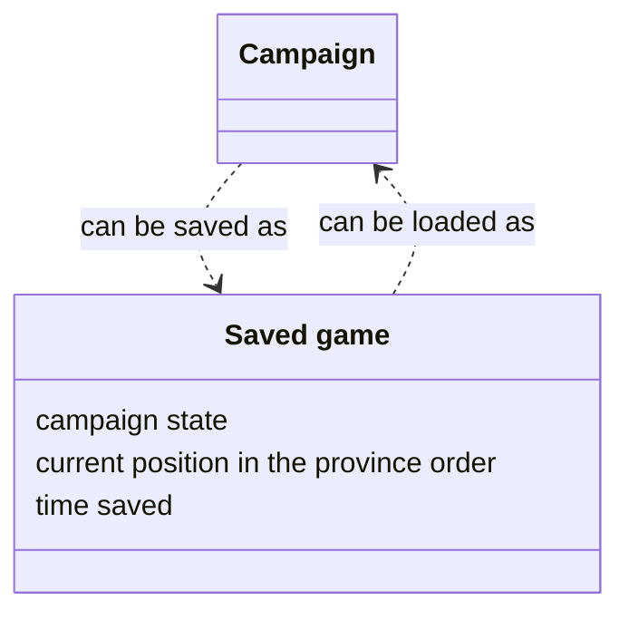

# 17. Save and load

**Status:** DRAFT

## Description

Save from the strategy screen and pick up from the same province turn after quitting or reopening the game. Three manual save slots let the player keep other campaigns or earlier points in the same campaign in this browser profile.

## Functionality

### Save Game

- Save from the strategy screen’s Menu while the active player-controlled province is ready for an order. The player can save after a completed free action, such as Trade. The game stays paused while the menu is open. Saving spends no action.
- **Save Game** lets the player choose a slot. Choosing an empty slot saves immediately. Choosing an occupied slot shows the existing save and asks **Replace saved game?** Cancel or Escape returns to the slot list. Replace saves the current campaign after checking again that the turn can be saved.
- Saving requires a settled turn. If an order is being prepared, the player must finish or cancel it. A battle, mandatory report or decision, computer turn, or campaign ending also makes saving unavailable. When the menu is reachable in one of these states, give the reason beside Save Game.
- A failed save leaves the game paused and preserves every slot. An unreadable slot still requires confirmation before replacement.

### Continue and Load Game

- **Continue** opens the most recently saved campaign that can be loaded. **Load Game** lets the player review all three slots and choose which save to load.
- Continue requires a usable save. Load Game is available when any slot contains a save and starts with the newest usable save selected. Empty and unreadable slots can’t be loaded. If the browser blocks access to saves, explain the problem and keep New Game available.
- After loading, select the saved province and show its turn number and available orders. Completed actions and monthly effects are already reflected in the game. The next turn-ending order or pass follows the saved province order.
- Keep every save available after loading and when starting a new campaign. Quit to Title preserves every save. The player chooses which one to replace.

## UI

```text
┌─ Gemstorm ──────────────────────────────────────────┐
│  [ Continue  <Crest>  <Date> ]                      │
│  [ New Game ]                                       │
│  [ Load Game ]                                      │
│  [ Options ]                                        │
└─────────────────────────────────────────────────────┘

┌─ Load Game ─────────────────────────────────────────┐
│  › [ Slot 1  <Crest>  <Date> ]                      │
│    Slot 2 · Empty                                   │
│    Slot 3 · Empty                                   │
│                                                     │
│  [Ruler]  <Family>                                  │
│           <Scenario>                                │
│           <Date> · <Active province>                │
│           Saved <local date and time>               │
│                                                     │
│                                  [ Back ] [ Load ]  │
└─────────────────────────────────────────────────────┘

┌─ Menu ──────────────────────────────────────────────┐
│  [ Resume ]                                         │
│  [ Saved to Slot 1 ]   (briefly, after saving)      │
│  [ Options ]                                        │
│  [ Quit to Title ]                                  │
└─────────────────────────────────────────────────────┘

┌─ Save Game ─────────────────────────────────────────┐
│  [ Slot 1  <Crest>  <Date> ]                        │
│  [ Slot 2  Empty ]                                  │
│  [ Slot 3  Empty ]                                  │
│                                                     │
│                                           [ Back ]  │
└─────────────────────────────────────────────────────┘

┌─ Replace saved game? ───────────────────────────────┐
│  Slot 1 · <Family> · <Scenario>                     │
│  <Game date> · <Active province>                    │
│  Saved <local date and time>                        │
│                                                     │
│                             [ Cancel ] [ Replace ]  │
└─────────────────────────────────────────────────────┘

┌─ Quit to Title ─────────────────────────────────────┐
│  Return to the title?                               │
│  Unsaved progress will be lost.                     │
│                                                     │
│                                  [ Stay ] [ Quit ]  │
└─────────────────────────────────────────────────────┘
```

## Research

### Manual saves and autosaves

One manual slot keeps saving simple. A player who wants to preserve an older turn or try another scenario eventually has to give up a save. More slots let the player keep another campaign or a point they want to revisit, at the cost of one extra choice when saving. The Gemfire NES manual describes two numbered saves and replacement of the selected slot. A third slot lets a player keep a second campaign and still bookmark an earlier turn. [Koei’s Gemfire manual, Quick Start p. 3](https://www.digitpress.com/library/manuals/nes/Gemfire.pdf)

Autosaves protect progress when a player forgets to save or the session ends unexpectedly. A rolling autosave can replace the moment a player wanted to revisit. Keeping it separate from manual saves protects deliberate saves and gives Load Game another source to show. Civilization VI combines named manual saves with per-turn autosaves. [Civilization VI manual, pp. 17–18](https://steamcdn-a.akamaihd.net/steam/apps/289070/manuals/CIV_VI_25TH_ONLINE_MANUAL_ENG.pdf#page=17)

### When saving is available

Saving at the start of a month would make a player replay every province turn since that save. Saving during a battle would let the player stop immediately, but resuming would have to return them to the same battle action or pending decision. A temporary suspend save offers that convenience for one return. Fire Emblem Awakening’s Classic mode uses a mid-battle bookmark that disappears after resuming. [Nintendo’s Fire Emblem Awakening manual](https://www.nintendo.com/eu/media/downloads/games_8/emanuals/nintendo_3ds_2/fire_emblem__awakening_1/ElectronicManual_Nintendo3DS_FireEmblemAwakening_EN.pdf)

### Choice for Feature 17

Use three manual slots and allow saving while a player province is ready for an order. This gives the player an exact place to resume after completed actions and reports, and spare slots for another scenario or an earlier turn. Continue opens the newest usable save. Load Game lets the player choose any of them. This leaves recovery after an unexpected close up to the player’s last manual save.

Keep the save in the current browser. File export would let players carry it to another device, with the extra step of managing a file. Cloud saves would move with the player’s account and would need a way to choose between conflicting saves. For this feature, continuing in the same browser is the priority.

## Domain model



The browser stores up to three saved games in numbered slots. A slot is the place the player chooses to save into. A saved game is its contents. The same campaign can be saved at different turns in several slots. Loading any save leaves its contents at the point where the player saved it.

## Persistence

Each slot records when its game was saved and the state of the campaign at that moment. Loading leaves the save time as it was. A successful replacement changes only the selected slot.

| State | What to save |
| --- | --- |
| Campaign | Scenario, player family, advisor, game date, market rate, and undiscovered artifacts. |
| Turn order | The active turn and the remaining province turns in their original order, including provinces that may change owners before they act. |
| Provinces | Ownership, governor, resources, development, Entrust, action count, goodwill, and ordered stationed units and hire offers. Keep each hired unit’s remaining Strength and each unused Nerith visit. |
| Families and generals | Family membership, ruler, capital, Fame, alliances, royal status, Gems and their ready dates. Include breakaway families. Preserve each general’s birth date, current stats, active house membership and lineage, recruitment and defection classes, capture immunity, and active or exiled status. |
| Captives | General, former family, captor, battlefield, and any ransom amounts still available. A refused ransom stays closed. |

Captives keep their house affiliation while their house is dissolved. If the house returns, its current court receives released captives and its current capital can pay their ransom. Saving preserves the effects of past events. Loading clears any announcements still waiting for those events. Future events resolve and are announced as usual.

## Tests

- **Continue at the same turn.** Trade, save in the middle of a month, reload, and Continue. Check the active province, exact turn, updated resources, and commands. A normal order or pass advances once to the next eligible province in the saved order. Month-start effects do not repeat.
- **Load Game.** Check the title order, crest, and in-game date for the newest usable save. Continue’s accessible label includes the family name. Load an older save and check that all saves remain available and Continue still points to the newest. Back or Escape returns focus to Load Game.
- **Keep event effects.** Save after a disaster damages a province that has yet to act. After loading, the province still has the reduced stores. When its turn comes up, the earlier disaster is neither announced nor applied again.
- **Restore changed campaign state.** Round-trip a moved capital, Entrust, alliances, a returning house with a captive and ransom, a resting Gem, a weakened hire, an unused Nerith, an exile, and the remaining artifacts. Check that the returning house can pay the ransom and receive the captive.
- **Respect save eligibility.** A player can save after a completed free action while the menu pauses play. An unfinished order or mandatory interruption blocks saving. The same rules apply when confirming replacement.
- **Protect every save.** Cover saving to an empty slot, cancelling or confirming replacement, and a rejected write. Check that writing one slot preserves the others, including after starting or quitting a different campaign. Check empty, corrupt, unsupported, or inaccessible saves on the title.
- **Keyboard and feedback.** Focus Continue when a usable save exists and New Game otherwise. Focus Cancel on replacement and return focus to the slot if cancelled. Announce save success and failure without moving focus. Verify saving, reloading, and continuing with the keyboard.
