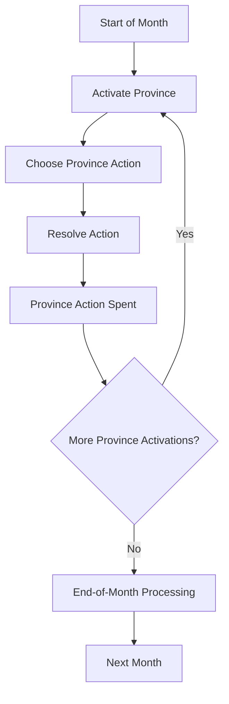
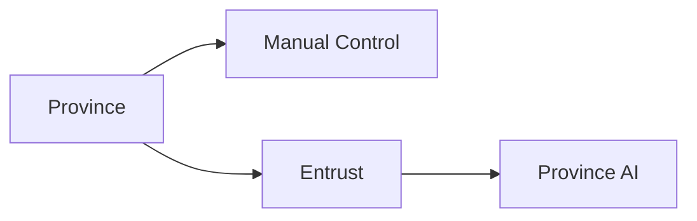

# 3. Turn Structure

## Purpose

This chapter describes Gemfire’s strategic time structure.

It defines:

- the monthly calendar;
- province-based activation;
- monthly province actions;
- free / administrative actions;
- Entrust;
- activation order uncertainty;
- end-of-month processing.

---

## 3.1 Calendar

### Confirmed Facts

Game time is divided into months.

One strategic cycle represents one month of in-game time.

Most strategic decisions are made within the monthly cycle:

- province development;
- recruitment;
- troop movement;
- diplomacy;
- search;
- invasion.

After the month is processed, the calendar advances to the next month.

---

### Seasonal Cycle

Gemfire includes seasonal economic and event timing.

September is especially important because it is associated with harvest and major resource gains.

Some disasters and special events are also tied to specific months or seasonal checks.

---

### Design Observation

Gemfire uses a large strategic time scale.

A single month is not a single battlefield action. It represents administrative, economic, diplomatic, and military activity across the realm.

This makes long-term planning more important than short tactical optimization on the strategic map.

---

## 3.2 Province-Based Activation

### Core Model

Gemfire is primarily organized around province actions rather than a single global “kingdom turn.”

Each controlled province can usually perform one significant action during the monthly cycle.

This makes the province the main unit of strategic activation.

---

### Monthly Province Action

A province’s monthly action can be used for systems such as:

- economic development;
- recruitment;
- troop or resource movement;
- diplomacy;
- search;
- invasion;
- hiring a Fifth Unit.

After most significant actions, the province’s monthly action is spent.

---

### Conceptual Model



---

### Design Observation

The province-based model creates one of Gemfire’s key strategic constraints:

> One province usually gets one meaningful action per month.

This forces tradeoffs between development, recruitment, diplomacy, logistics, and war.

---

## 3.3 Turn-Consuming Commands

### Overview

Most important strategic commands consume the province’s monthly action.

The exact behaviour of some commands may vary by version or still requires verification, but the general structure is clear: major strategic actions are costly because they use the province’s action for the month.

---

### Command Table

The major strategic commands (Develop, Give Food, Recruit, Attack, Transport, Hire Monster, the Diplomacy commands, and Search) each consume the province's monthly action; the full command-by-category breakdown and which commands consume the monthly action are canonical in Appendix D §D.1–D.2 and §D.4.

---

### Notes

`Hire Monster` is the original command name, but the command can provide both monsters and elite human units.

`Transport / Move` terminology can vary depending on context and version.

---

## 3.4 Non-Turn-Consuming and Administrative Commands

### Overview

Some commands do not appear to consume the province’s main monthly action.

These are mostly informational or administrative actions.

---

### Known or Strongly Supported Examples

Commands such as Trade (buy or sell Food), View / Enquiry, Change Lord, and Entrust are mostly informational or administrative and do not end the province's main action; which commands consume the monthly action is canonical in Appendix D §D.4.

---

### Design Observation

Free or administrative commands reduce friction.

For example, Trade being non-turn-consuming lets the player adjust resources before choosing the province’s main action.

---

## 3.5 Entrust

### Confirmed Facts

Entrust allows the player to delegate a province to AI control.

An entrusted province is managed automatically by the computer.

Entrust operates at the province level, not at the whole-house level.

---

### Conceptual Model



---

### Design Observation

Entrust confirms the province-centered structure of Gemfire.

The player can automate individual provinces rather than handing over the entire realm.

This is mainly a convenience system for reducing micromanagement.

---

## 3.6 Province Activation Order

### Current Understanding

The exact province activation order is not fully confirmed.

Observed behaviour suggests that the monthly sequence is not simply:

```text
Player takes all actions
↓
AI takes all actions
```

Instead, province actions appear to be processed through a broader province activation sequence.

A captured province may be able to act later in the same month if its activation has not yet occurred.

---

### Working Model

The current working model is:

1. At the start of the month, the game determines or follows a province activation order.
2. Provinces receive opportunities to act according to that order.
3. Ownership changes during the month may affect later activations.
4. After all relevant province activations are complete, end-of-month processing occurs.

---

### Confidence Level

The province-based model is strongly supported, but the exact internal ordering rules remain unresolved.

---

## 3.7 End-of-Month Processing

### Overview

After province activations are complete, the game performs systemic processing.

Known or strongly supported processing includes:

- calendar advancement;
- economic updates;
- seasonal checks;
- event checks;
- disaster checks;
- Gem cooldown progression;
- hired Fifth Unit upkeep checks;
- victory / defeat checks.

The exact order of these operations is not fully verified.

---

### Seasonal Processing

Some systems are tied to specific months.

Examples include:

| Month / Timing              | Known or Likely Processing                                            |
| --------------------------- | --------------------------------------------------------------------- |
| September                   | Harvest and major resource gains.                                     |
| Quarterly / seasonal months | Disasters, plague checks, some event processing.                      |
| Every month                 | Calendar advancement, cooldown progression, AI / province processing. |

---

## 3.8 Turn Structure Summary

Gemfire’s turn structure is one of its most distinctive systems.

The game is not structured only around whole-faction turns. Instead, it relies heavily on province-level activation and province-level monthly actions.

This creates a strategic rhythm where each province must choose between:

- development;
- recruitment;
- logistics;
- diplomacy;
- search;
- attack;
- hiring or maintaining military assets.

The result is a compact but demanding strategic system where local decisions accumulate into realm-wide momentum.

---

---

## Detailed rules: The Month

### Start-of-month processing

All periodic processing happens at the **start** of a month, before any province acts, in this order. 1. Advance the month. After December the year and every character's age advance.
2. **September only:** harvest ([September Harvest](./04-economy-system.md#detailed-rules-september-harvest)).
3. **January only:** yearly decay, deaths from old age, yearly stat change ([January: Decay, Ageing, Death](./05-characters.md#detailed-rules-january-decay-ageing-death)).
4. **March, June, September, December:** quarterly upkeep, then plague, then that season's regional disaster ([Upkeep, Rampage, Desertion, and Disasters](./11-events.md#detailed-rules-upkeep-rampage-desertion-and-disasters)).
5. **Every month:** monster rampage, mercenary desertion, the policy event check ([Policy Events](./11-events.md#detailed-rules-policy-events)), Fifth Unit recovery, Gem rest counters.
6. **February, May, August, November:** market rate change ([Trade](./04-economy-system.md#detailed-rules-trade)).
7. **February, August:** hire pool restock. **March, September:** hire pool migration ([Recruit, Hire, and the Hire Pool](./08-monsters.md#detailed-rules-recruit-hire-and-the-hire-pool)).
8. Roll the province order for the month.

### Province order

The order is **per province, not per family**, and is re-rolled every month. ```text
for province 0 … 29:
    position = rand(30)
    while position is taken: position = (position + 1) mod 30
    order[position] = province
```

Because a taken position is resolved by stepping forward, this is not a uniform shuffle.

### Province turns

- Provinces act in the rolled order. Unowned provinces are skipped.
- A province gets **exactly one** turn-ending command. It never appears twice in the order.
- Trade, View, save, and options do not end the turn and may be repeated.
- An attack is resolved immediately, before the next province acts.
- Ownership is read when a province's position comes up. A province captured earlier in the month still acts, under its new owner, if its position is later. (Likely — this follows from the loop and is not handled specially.)
- The unification check runs after every province turn: one family owning all 30 provinces ends the game.

---

---

## Detailed rules: Victory and Defeat

- **Unification:** checked after every province turn. One family owning all 30 provinces ends the game. A human winner sees the ending; a computer winner ends the game as a loss.
- **Losing the ruler's province:** the family moves to another of its provinces at random. If it has none, it claims an empty neighbouring province. If there is none, the family is destroyed.
- **No successor:** a human family whose ruler dies with no successor is out of the game.
- **Everyone dead:** if the January deaths leave no living general anywhere, the game ends.
- The game continues while at least one human family remains.

---

---

## Detailed rules: Change Lord and Entrust

### Change Lord

Issued from the ruler's home province. The target is any **other** province of the family; adjacency is not required, and it may or may not already have a lord.

There is no stored "home province". Home is wherever the ruler is.

| Choice | Effect |
| ------ | ------ |
| **You** | The target's lord is recalled to the ruler's court as a vassal. The target is left without a general, ruled directly. Its Entrust setting is cleared. The ruler does not move. |
| **Lord** | A second own province is chosen, and the two provinces **swap** whoever leads them. Either may be empty, so this also moves a lord into a province without one. |
| **Vassal** | A court vassal becomes lord of the target. The target's old lord, if any, takes that vassal's place at court. |

**Moving the ruler** is the Lord choice with the home province as the second province. The ruler's whole court moves with him; the old home receives the target's former lord, or is left without a general. The game asks "OK to move yourself?" first.

**Turn cost:**

- Moving the ruler ends the turn. It counts as a command with a policy value of 0.
- **Every other reassignment is free.** The command returns to the province prompt, so any number of lords can be reassigned in one visit.

There are no stat, Fame, Loyalty, or resource effects, and no randomness.

A province ruled directly uses half the ruler's stats for every command and for battle, so recalling a lord has a real cost.

### Entrust

- May be set or cleared on any own province **except the one the ruler is in**. A province without a general can be entrusted.
- Can be issued from any province of the family.
- Free: it never ends the turn, and several provinces can be toggled in one visit.
- Cleared automatically, and only, in these cases:
  - the province changes owner or becomes unowned;
  - the ruler arrives in it (Change Lord, a retreat, a return from a failed attack, a release from captivity, or an heir succeeding there);
  - the **You** choice of Change Lord recalls its lord;
  - the player retires from the game, which clears it for the whole family.
- Otherwise it persists. Losing its lord does not clear it.


---

---

