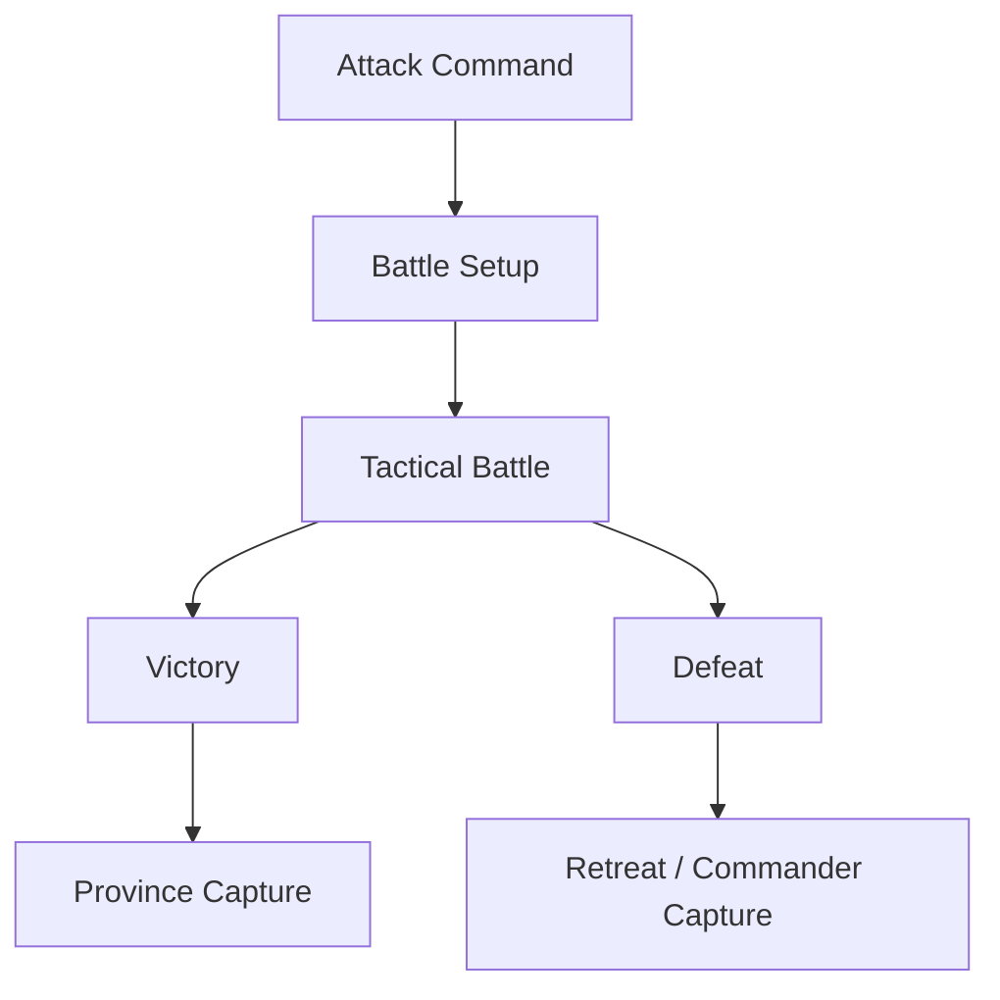
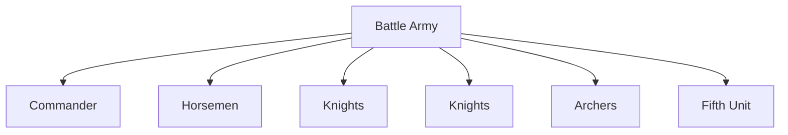
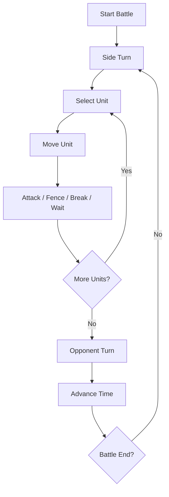
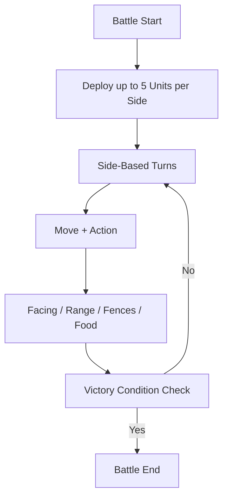

# 9. Tactical Battle System

## Purpose

This chapter describes Gemfire’s tactical battle system.

Tactical battle is a separate turn-based phase that starts when one province invades another.

The tactical system resolves conflict between two armies through:

- unit positioning;
- flag capture;
- unit destruction;
- food supply;
- Fifth Units;
- movement;
- fences;
- flanking and rear attacks.

---

## 9.1 Battle Overview

### Confirmed Facts

Tactical battle takes place on a separate grid-based battlefield.

Each side fields up to five battlefield units:

```text
Horsemen
Knights
Knights
Archers
Fifth Unit
```

The commander does not occupy a battlefield cell and is not a separate unit.

The commander influences army effectiveness through character stats.

---

### Battle Model



---

### Design Observation

Gemfire’s battles are compact tactical encounters, not large-scale wargame simulations.

The system creates tactical depth through a small number of strong rules:

- flags;
- food supply;
- facing;
- fences;
- Fifth Units;
- range patterns;
- commander influence.

---

## 9.2 Battlefield Layout

### Grid

The battlefield uses a fixed-size grid:

```text
10 × 8 cells
```

---

### Deployment

Known starting layout:

| Side     | Starting Area                 |
| -------- | ----------------------------- |
| Attacker | Left side of the battlefield  |
| Defender | Right side of the battlefield |

---

### Flags

Each side has its own flag.

The enemy flag is a primary tactical objective.

Capturing the enemy flag is one way to win the battle immediately.

---

### Province-Specific Battlefields

Battlefield layout depends on the province, and all thirty layouts are known: each is
eighty tiles, ten columns by eight rows, canonical in `data/battlefields.json`.

The tile kinds are the manual's own two lists — Plains, Woods, River, Boulder as terrain,
and Fence, Bridge, Castle Wall as the features that obstruct and protect — plus one flag
tile per side. Fences appear pre-placed on the field as well as being buildable in battle
(§9.13), and the castle wall encloses the defending flag on three sides, leaving one
approach. The attacker's flag stands in column 0 on every board; the defender's in
columns 6 to 9.

Layouts follow the regional character §11 uses for seasonal disasters: the woodland
region's fields average 12.2 woods cells and no water or stone, the wetland region's
10.4 river cells, the volcanic region's 12.5 boulders, and the northern region's are open
plains — against whole-map averages of 5.6 woods, 2.8 river and 1.7 boulder.

---

### Design Observation

The tactical map acts like a compact capture-the-flag arena.

The player can win not only by destroying the enemy, but also by manoeuvring toward the flag.

---

## 9.3 Battle Participants

### Standard Units

Before battle, strategic Troops are automatically converted into four standard units:

```text
Horsemen
Knights
Knights
Archers
```

If Troops do not divide evenly, the remainder is assigned to Horsemen.

---

### Fifth Unit

The fifth slot is occupied by one special unit:

- Gem Guardian;
- Hired Fifth Unit;
- Pastha.

An army can have only one Fifth Unit.

---

### Commander

The commander:

- does not occupy a cell;
- is not one of the five units;
- influences army effectiveness;
- may be captured after defeat.

---

### Battle Composition



---

## 9.4 Battle Setup

### Inputs

Before battle, the system uses:

- attacking province;
- defending province;
- commander;
- number of Troops;
- allocated Food;
- selected Fifth Unit;
- Gem availability;
- hired Fifth Unit availability;
- deployment cost.

---

### Deployment Cost

An attack requires Gold to deploy; the deployment cost is set on the strategic side (military chapter §6).

---

### Food Requirement

Food determines how many days the army can remain in battle; the daily consumption rate is set on the strategic side (military chapter §6), and Gem Guardians do not count toward it.

---

### Design Observation

Supply is part of the tactical battle system, not only strategic logistics.

The player must plan both army strength and battle duration.

---

## 9.5 Battle Time and Food

### Days

Battle is measured in days. One battle day is 4 turns per side.

---

### Time of Day

Battle phases visually correspond to time of day. The day cycles sunrise → noon → sunset → night.

---

### Food Timer

During battle, the interface tracks:

- remaining Food;
- number of supply days.

If an army runs out of Food, it can lose the battle.

---

### Design Observation

Food works as a pressure timer.

The attacker cannot fight indefinitely and must achieve victory before supply runs out.

---

## 9.6 Turn Structure

### Side-Based Turns

Tactical battle uses side-based turns.

On its turn, a side activates its units.

---

### Unit Activation

A typical unit activation follows this pattern:

```text
Select Unit
↓
Move
↓
Action
```

After acting, the unit ends its activation for the current turn.

---

### Battle Turn Flow



---

## 9.7 Battle Commands

### Unit Commands

| Command | Availability                       | Effect                      |
| ------- | ---------------------------------- | --------------------------- |
| Move    | All units                          | Move across the grid.       |
| Attack  | Units with a valid target in range | Attack an enemy unit.       |
| Fence   | Knights only                       | Build a fence obstacle.     |
| Break   | All units                          | Attempt to destroy a fence. |
| Wait    | All units                          | End the unit’s action.      |

---

### Army-Level Commands

| Command | Effect                              |
| ------- | ----------------------------------- |
| Retreat | Attempt to withdraw from battle.    |
| Auto    | Let AI control the tactical battle. |

---

### Non-Mechanical Options

Battle may include interface options, such as animation settings.

These options do not change battle mechanics.

---

## 9.8 Standard Unit Rules

### Horsemen

#### Role

Fast melee unit.

#### Properties

Movement 3, Short/Close range; canonical stats in Appendix C §C.1.

#### Design Role

Horsemen are useful for:

- rapid advance;
- flanking;
- rear attacks;
- flag pressure;
- exploiting openings.

---

### Knights

#### Role

Frontline melee unit.

#### Properties

Movement 2, Short/Close range; canonical stats in Appendix C §C.1.

#### Special Ability

Knights can build fences.

---

### Knights 2

The second Knights unit appears to be mechanically identical to the first.

#### Design Role

Having two Knights units creates a stable frontline and gives the player more control over space.

---

### Archers

#### Role

Ranged support unit.

#### Properties

Movement 2, Long range; canonical stats in Appendix C §C.1.

#### Restrictions

Archers:

- cannot attack adjacent cells;
- cannot attack diagonally.

#### Advantages

Archers:

- attack at range;
- can shoot over units and obstacles;
- do not suffer backlash / counter-damage when attacking.

---

## 9.9 Fifth Unit Rules

### Overview

A Fifth Unit is a special battlefield unit.

It may have unique values for:

- Strength;
- movement;
- attack range;
- special movement traits;
- special attack pattern.

---

### Categories

A Fifth Unit can be:

- Gem Guardian;
- Hired Fifth Unit;
- Pastha.

---

### Strength

Fifth Units use Strength instead of ordinary troop count.

Strength represents combat effectiveness and durability.

---

### Range Patterns

The four range categories (Short/Close, Long, Circular, Largest) and their tile diagrams are canonical in Appendix C §C.6. "Outer" is not a distinct range — Skulryk's range is Circular.

---

## 9.10 Movement Rules

### Movement Points

Each unit has a movement value.

Movement determines how many cells a unit can move during activation.

---

### Obstacles

Movement may be blocked by:

- fences;
- trees;
- rivers;
- other battlefield obstacles.

---

### Flying Units

Some Fifth Units can fly.

Confirmed flying units:

- Gargoyles;
- Wyverns.

Flying units can pass over:

- fences;
- trees;
- rivers.

---

### Design Observation

Movement rules make Fifth Units tactically distinct.

Even with similar Strength, a flying unit can be more valuable because it ignores key obstacles.

---

## 9.11 Attack Resolution

### Attack Types

Attacks differ by range pattern (Short/Close melee, Long ranged, Circular and Largest area attacks); the canonical patterns are in Appendix C §C.6.

---

### Backlash / Counter-Damage

Melee attacks may cause backlash / counter-damage to the attacker.

Long-range attacks do not cause backlash.

---

### Commander Influence

The commander’s WAR / Military rating affects combat results.

High WAR improves the effectiveness of subordinate troops.

Exact damage formulas remain unresolved.

---

### Design Observation

Even on a small grid, the battle system creates meaningful tactical choices:

```text
Safe ranged attack
vs
risky melee attack with stronger positional potential
```

---

## 9.12 Facing System

### Attack Direction

Attack effectiveness depends on direction: front is the worst attack direction, flank is better, and rear is best. Exact numeric modifiers are unknown.

---

### Rear Attack

Rear attacks produce the strongest results and reduce retaliation risk.

Exact numeric modifiers remain unresolved.

---

### Design Observation

Facing is one of the main sources of positional depth.

A well-executed manoeuvre can decide the battle even when unit strength is similar.

---

## 9.13 Fences

### Overview

Fences are temporary battlefield obstacles.

They are used to:

- protect the flag;
- delay enemies;
- block paths;
- create temporary defensive lines.

---

### Building Fences

Only Knights can build fences.

Command:

```text
Fence
```

---

### Breaking Fences

Any unit can attempt to destroy a fence.

Command:

```text
Break
```

---

### Failure Chance

Fence construction and destruction can fail.

Success probably depends on the unit’s strength or troop count.

The exact formula is not confirmed.

---

### Flying Units

Flying units can ignore fences.

---

### Design Observation

Fences turn battle into a space-control problem.

They are especially important for defenders because they help protect access to the flag.

---

## 9.14 Victory Conditions

### Confirmed Victory Conditions

A side wins by:

1. capturing the enemy flag;
2. destroying all enemy units;
3. the enemy running out of Food;
4. the enemy retreating;
5. the defender holding the flag for 5 days.

---

### Flag Capture

Capturing the enemy flag is an immediate victory condition.

There is no confirmed requirement to hold the flag for multiple turns.

---

### Defender Endurance

The defender can win by preventing flag capture for long enough — holding the flag for 5 days.

---

### Starvation

If an army runs out of Food, it can lose regardless of remaining units.

---

### Design Observation

The victory system creates several valid battle plans:

| Strategy  | Goal                        |
| --------- | --------------------------- |
| Assault   | Destroy enemy units.        |
| Raid      | Reach and capture the flag. |
| Defense   | Hold the flag for 5 days.   |
| Attrition | Exhaust enemy Food.         |
| Pressure  | Force retreat.              |

---

### Resources saved after a defender loses

If the defender has an adjacent province to fall back to, the force saves Gold and Food according to the commander's INT and soldiers according to WAR:

```text
rate(stat) = min(10, stat ÷ 10)
             (or min(10, ruler stat ÷ 20) if no commander is present)
rescued Gold = Gold × rate(INT) ÷ 10
rescued Food = Food × rate(INT) ÷ 10
rescued soldiers = Soldiers × rate(WAR) ÷ 10
```

All division rounds down. Add each rescued resource to the corresponding resource in the fallback province.

If there is no adjacent fallback province, all defending soldiers are lost and the province loses 30–50% of its Gold and Food. After an attacker wins, its remaining Food is added to the province, its survivors become the province's soldiers, and the province's Loyalty becomes 0.

---

## 9.15 Retreat

### Overview

An army can attempt to retreat from battle.

---

### Effects

Retreat ends the battle and preserves part of the army.

---

### Commander Risk

The commander may still be captured after retreat.

Exact risk is unresolved.

---

### Restrictions

Retreat may be unavailable if there is no suitable neighbouring territory to retreat into.

Exact retreat availability rules require further verification.

---

## 9.16 Tactical AI

### Observed Behaviour

Battle AI appears to consider relative strength and supply.

Observed patterns include:

- if the player has a strong advantage, AI often defends the flag;
- if AI has parity or advantage, it may attack;
- if AI can outlast the player’s Food supply, it may defend;
- AI may retreat when threatened with destruction;
- AI is less likely to retreat when its flag is under immediate threat.

Exact AI rules remain unresolved.

---

## 9.17 Tactical Battle Summary

### Reconstructed Battle System



---

---

## Detailed rules: Tactical Battle

The battle code never reads a difficulty or scenario setting.

### Sides and units

Side WAR is one number for the whole army: the commander's WAR, where the commander is the first general in the province. With no general present it is the family ruler's WAR ÷ 2.

There is **no commander unit** on the field.

The pooled soldier count is split when the battle starts:

```text
quarter = soldiers × 25 ÷ 100
Knights = Archers = Knights = quarter
Horsemen = soldiers − 3 × quarter
```

| Unit           | Move | Range     | Attack | Defence | Builds fences |
| -------------- | ---- | --------- | ------ | ------- | ------------- |
| Horsemen       | 3    | Adjacent  | 21     | 20      | No            |
| Knights (two)  | 2    | Adjacent  | 20     | 19      | Yes           |
| Archers        | 2    | Straight 2 | 18    | 18      | No            |

Fifth Unit values:

| Unit      | Strength | Attack | Defence | Move | Range      |
| --------- | -------- | ------ | ------- | ---- | ---------- |
| Ogre      | 100      | 26     | 27      | 2    | Adjacent   |
| Orks      | 100      | 20     | 20      | 3    | Adjacent   |
| Olog-hais | 110      | 21     | 18      | 2    | Adjacent   |
| Gargoyles | 120      | 23     | 25      | 3    | Adjacent (flies) |
| Lizards   | 110      | 27     | 28      | 3    | Adjacent   |
| Skeletons | 100      | 18     | 19      | 2    | Adjacent   |
| Bugbear   | 100      | 20     | 24      | 3    | Adjacent   |
| Fachan    | 100      | 26     | 23      | 3    | All within 2 |
| Wyvern    | 150      | 29     | 30      | 3    | Adjacent (flies) |
| Gunners   | 150      | 27     | 21      | 3    | Straight 2 |
| Shooters  | 150      | 24     | 22      | 3    | Straight 2 |
| Spearmen  | 150      | 22     | 21      | 3    | Straight 2 |
| Pikemen   | 150      | 25     | 26      | 3    | Adjacent   |
| Lancers   | 180      | 27     | 26      | 3    | Adjacent   |
| Warriors  | 180      | 28     | 27      | 3    | Adjacent   |
| Pluvius   | 160      | 29     | 29      | 2    | Ring at 2  |
| Zendor    | 150      | 28     | 28      | 3    | Ring at 2  |
| Skulryk   | 110      | 22     | 22      | 3    | Ring at 2  |
| Empyron   | 140      | 25     | 25      | 2    | Adjacent   |
| Scylla    | 130      | 24     | 24      | 2    | Adjacent   |
| Chylla    | 120      | 22     | 23      | 3    | Adjacent   |
| Pastha    | 160      | 30     | 29      | 2    | Adjacent   |
| Dragon    | 160      | 30     | 30      | 2    | All within 2 |

"Special units" below means the six Gem Guardians, Pastha, and the Dragon.

Range shapes, with no line-of-sight check:

- **Adjacent:** the 4 orthogonal neighbours.
- **Straight 2:** exactly 2 tiles away in a straight line. Cannot hit an adjacent tile.
- **Ring at 2:** the 16 tiles at distance 2 (diagonals count as 1).
- **All within 2:** all 24 tiles within distance 2.

### Turn structure

- A battle lasts at most **5 days of 4 turns each**. In each turn the defender moves first.
- Each unit may move, then give one command: Attack, Build fence, Break fence, or Done.
- Cancelling the command menu takes the move back.

### Movement and terrain

- Every step costs 1 Move point. Steps are orthogonal.
- **Terrain never changes damage.** It only blocks movement.
- A tile holding any unit is blocked.
- Obstacles and fences block ground units. Gargoyles and Wyvern fly over them. Some obstacles block everyone.

### Facing

A unit faces the direction of its last step, or toward its target when it attacks. A defender never turns to meet an attack.

| Attack from | Damage to target | Melee attacker's own losses |
| ----------- | ---------------- | --------------------------- |
| Front       | ×1.0             | ×1.0                        |
| Flank       | ×1.5             | ×0.9                        |
| Rear        | ×2.0             | ×0.7                        |

Front means the two units face each other; rear means they face the same way.

### Melee

Used when an ordinary unit with Adjacent range attacks. Both sides take losses in one step; there is no separate counter-attack.

```text
power(u) = WAR(u's side) × Strength(u) ÷ 50 + 1

PD = ((power(D) + 10) ÷ 10) × Defence(D)
PA = ((power(A) + 10) ÷ 10) × Attack(A)

R = PD × 100 ÷ (PD + PA), clamped to 1 … 99      (defender's share)
Q = 100 − R
S = R² + Q²

lossD = Q ÷ R + (Strength(D) × (90 + rand(21)) ÷ 100 × Q² ÷ S) ÷ 3 + 1
lossD = lossD × facing(target) ÷ 10

lossA = R ÷ Q + (Strength(A) × (90 + rand(21)) ÷ 100 × R² ÷ S) ÷ 3 + 1
lossA = lossA × facing(attacker) ÷ 10
```

Both losses use the Strengths from before the exchange. The defender's roll comes first.

Roughly: an evenly matched exchange costs each side about one sixth of its Strength; a one-sided one costs the weaker side up to a third.

### Ranged

Used when an ordinary unit with any other range attacks. No randomness, and the attacker takes no losses.

```text
d = (WAR ÷ 8) × (Strength(A) ÷ 10 + 1) ÷ 9 + 1
d = d × Attack(A) ÷ 15
d = d × facing(target) ÷ 10
d = d × (50 − Defence(D)) ÷ 32
```

### Special-unit attack

Used when a special unit attacks, whatever its range. WAR is not used, and there is no randomness.

```text
d = (Strength(A) ÷ 10 + 1) × Attack(A) ÷ 13
d = d × facing(target) ÷ 10
d = d × (50 − Defence(D)) ÷ 32

Strength(A) −= Strength(A) ÷ 10        (the attacker tires by 10% per attack)
```

The attack hits one target. There is no area effect, and no per-battle limit on its use.

### Removal

- Ordinary units are removed at Strength 0.
- A special unit cannot be reduced below 1 by damage, but **withdraws once its Strength is below one tenth of its maximum**. Its own 10% tiring counts toward this.

### Fences

One formula covers both building and breaking:

```text
chance % = min(100, (Strength ÷ 6) × 6 + 6 + WAR ÷ 20)
```

- Build: only the two Knights units, on an empty plain tile next to them.
- Break: any unit, on an adjacent fence.
- A fence has no durability. One success removes it.
- A unit with Strength 96 or more never fails.
- Either attempt uses the unit's command for the turn.

### Food

```text
consumption = (soldiers left + ordinary Fifth Unit Strength) ÷ 10 + 1
```

Taken at the start of every day, including the first. Special units eat nothing.

At the end of each day: if the attacker has no food the defender wins; otherwise if the defender has none the attacker wins.

### Victory

Checked after every unit action:

1. A unit standing on the enemy base wins.
2. A side with no soldiers and no Fifth Unit loses.
3. A side that retreats loses.
4. Food, at the end of the day.
5. After day 5 the **defender** wins.

### Retreat

- Allowed if the ruler's home province is somewhere other than the battlefield, or the battlefield borders one of the family's own provinces.
- Destination: Home, or an adjoining own province.
- Retreating to a non-adjacent Home leaves supplies behind.
- There is no surrender inside a battle. Surrender is offered before it, and only to a defender who cannot fight (no food, or no soldiers and no usable Fifth Unit).

### Aftermath

"Day" is the day the battle ended on. `rate(stat) = min(10, stat ÷ 10)` for the loser's commander, or `min(10, ruler stat ÷ 20)` if there was none.

**Attacker won:**

```text
if the defender has an adjacent province to fall back to:
    it takes  Gold × rate(INT) ÷ 10,  Food × rate(INT) ÷ 10,  Soldiers × rate(WAR) ÷ 10
else:
    all defending soldiers are lost
    the province loses 30–50% of its Gold and of its Food

province Food += attacker's remaining food
province Soldiers = attacker's survivors
province Loyalty = 0
```

Add the rescued Food amount to the fallback province’s Food.

**Defender won:**

```text
if the attacker's origin is adjacent:  origin Soldiers += survivors × rate(WAR) ÷ 10
else:                                  all attacking soldiers are lost
province Food += attacker's remaining food
province Loyalty = Loyalty × (90 + rand(6) − 4 × Day) ÷ 100
```

**Either way**, the battlefield province loses:

```text
Cultivation −= Cultivation × 2 × Day ÷ 45 + rand(2) + 1
Protection  −= Protection  × 2 × Day ÷ 45 + rand(2) + 1
```

**Fame**: the winning family's ruler gains 3 if attacking or 1 if defending; the losing ruler loses the same amount.

### Capture of the losing commander

```text
no province to flee to, or the defender surrendered → captured
otherwise chance % = max(0, 115 − WAR)   if the attacker won
                     max(0, 110 − WAR)   if the defender won
```

One character (general number 30, Eselred) can never be captured this way.

**Ransom** offered for a prisoner:

```text
s = INT + WAR
Gold = s ÷ 5 + 10
Food = (s ÷ 5) × 2 + 10
```

Both are multiplied by 1.5 for a member of the losing ruler's own house. (Likely.)

---

---

## Detailed rules: Auto-Resolved Battles

Used when neither side is human-controlled, except in demo mode. Up to 5 rounds:

```text
each side: food −= soldiers ÷ 10 + ordinary Fifth Unit Strength ÷ 10 + 1

power = (WAR + soldiers) ÷ 2 + 1
if the side has a Fifth Unit: power += min(150, (WAR + soldiers) ÷ 5)

R = defender's share of total power, clamped 1 … 99;  Q = 100 − R;  S = R² + Q²

defender loses  Q ÷ R + (soldiers × (80 + rand(41)) ÷ 100 × Q² ÷ S) ÷ 3 + 3
attacker loses  R ÷ Q + (soldiers × (80 + rand(41)) ÷ 100 × R² ÷ S) ÷ 3 + 3
a side's Fifth Unit loses  that side's loss ÷ (2 … 5)

attacker wiped out or out of food → defender wins
defender wiped out or out of food → attacker wins
```

After 5 rounds without a result the defender wins. Only the presence of a Fifth Unit matters, not its kind. The normal battle aftermath then applies, with the round number as the day.

---

---

## Detailed rules: Battlefields

### Selection

- There are 30 battlefields, **one per province**. A battle uses the battlefield of the province being fought over.
- Nothing else affects the choice: not the attacking province, the direction of attack, the season, or the scenario.
- The board is never mirrored. The attacker is always on the left, the defender on the right.

The 30 battlefields are listed in `data/battlefields.json`.

### Terrain

| Terrain            | Blocks                     | Notes                                         |
| ------------------ | -------------------------- | --------------------------------------------- |
| Plains             | Nothing                    | The only tile a fence can be built on.        |
| Bridge             | Nothing                    | Crosses a north–south river.                  |
| Base (each side)   | Nothing                    | Exactly one per side.                         |
| Woods              | Ground units               |                                               |
| Boulder            | Ground units               |                                               |
| Fence              | Ground units               | Breakable; pre-placed on some boards.         |
| River (four shapes) | Ground units              | Crossed only by bridge or by flying.          |
| Castle wall (four shapes) | **Every unit, flyers too** | Cannot be broken.                        |

Flyers are Gargoyles and Wyvern.

No terrain changes movement cost, damage, or range. Woods, boulders, and rivers do not stop ranged attacks. (Likely for the absence of any other effect — the battle code compares no other terrain value.)

### Bases and start positions

- The attacker's base is always in the leftmost column, on one of the attacker's start tiles.
- The defender's base is 1 to 4 columns in from the right edge on most boards, so the defender starts **behind** it only loosely; on three boards (Norwood, Erewood, Rodale) it is in the rightmost column.
- Units start in the outer column of their side, rows 3 to 7 of 8, one per row.

### Fences

- Pre-placed fences and fences built in battle are the same thing and equally breakable.
- A fence can be built only on plains: not on a bridge, a base, or an occupied tile.
- A broken fence becomes plains. There is no "broken fence" terrain.

### What changes during a battle

Only fences. No terrain is destroyed, nothing is placed at random, and rivers never freeze.

The four turns of each day are tinted as times of day. This is purely visual.

---

---

## Summary

Gemfire’s tactical battle is a compact turn-based system on a 10×8 grid.

Despite the small number of units, battle has meaningful depth through:

- fixed army composition;
- Fifth Units;
- flags;
- supply;
- time pressure;
- facing;
- fences;
- limited movement;
- different range patterns.

Battle is not only a contest of army strength. It is also a positional problem: the player can win through destruction, manoeuvre, defense, attrition, or forced retreat.
