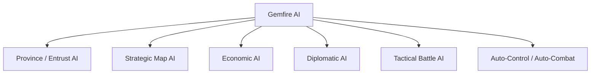
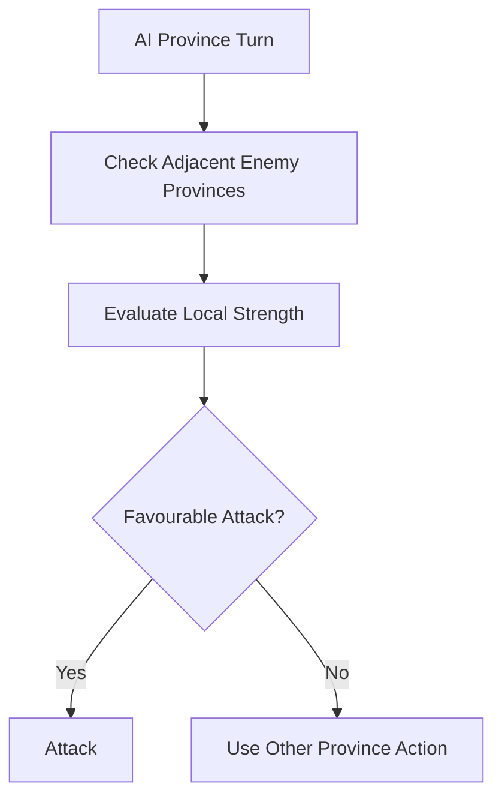
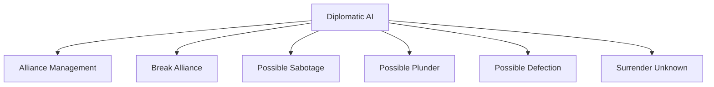
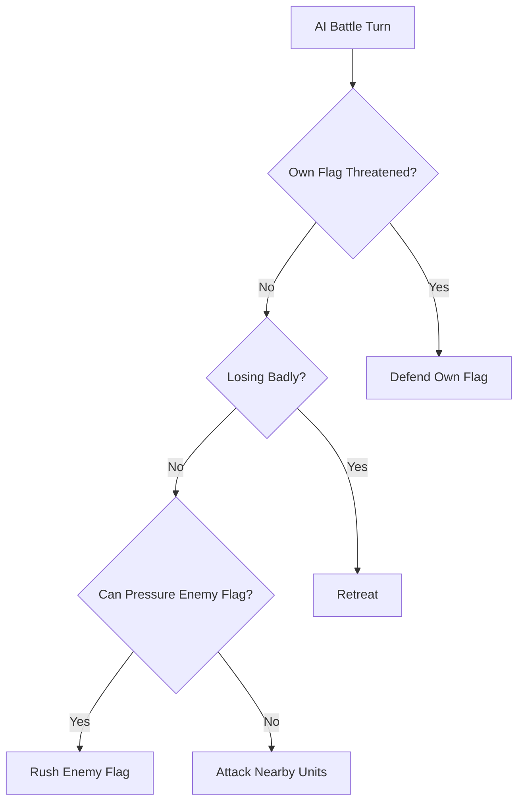
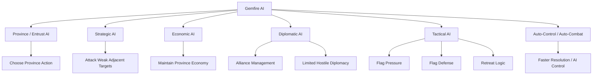

# 13. AI Specification

## Purpose

This chapter describes Gemfire’s artificial intelligence.

Gemfire’s AI does not appear to be a deep strategic planner that builds long-term plans at a human level. It is better understood as a set of simple heuristics that keep the campaign active:

- managing provinces;
- maintaining basic economies;
- attacking weak borders;
- automating provinces through Entrust;
- controlling armies in tactical battles;
- using limited diplomacy.

The main role of the AI is not to outthink the player through complex planning. Its role is to keep Ishmeria active, reactive, and dangerous enough for the player to face constant pressure.

---

## 13.1 AI Layers

### Overview

Gemfire’s AI can be divided into several layers:

```text
AI
├── Province / Entrust AI
├── Strategic Map AI
├── Economic AI
├── Diplomatic AI
├── Tactical Battle AI
└── Auto-Control / Auto-Combat
```

---

### Layer Model



---

### Design Observation

AI operates on the same major layers as the player:

- provinces;
- economy;
- warfare;
- diplomacy;
- tactical battle.

Available evidence suggests that the AI relies on simple rules rather than deep long-term planning.

---

## 13.2 Province / Entrust AI

### Overview

Entrust allows the player to delegate control of a specific province to the computer.

Entrust does not hand over the whole house.

It operates at the province level.

---

### Function

An entrusted province:

- receives automated management;
- can perform commands without manual player input;
- may also do nothing;
- reduces micromanagement in the late game.

---

### Known Use Cases

Entrust is most useful:

- in the late game;
- when the player controls many provinces;
- for rear or secondary territories;
- when the player does not want to manually order every province.

---

### Limitations

Entrust AI is not considered optimal.

It should not be relied on for:

- important border provinces;
- provinces preparing invasions;
- territories with critical economic tasks;
- situations requiring precise timing or logistics.

---

### Current Understanding

The exact priority order of Entrust AI is unknown.

It is not confirmed how the AI chooses between:

- Develop;
- Recruit;
- Attack;
- Transport;
- Hire Monster;
- Diplomacy;
- no action.

---

### Design Observation

Entrust AI is a convenience system.

Its purpose is to reduce management burden, not to play optimally for the player.

---

## 13.3 Strategic Map AI

### Overview

Strategic AI controls houses on the global map.

It chooses:

- which provinces to develop;
- where to recruit troops;
- which neighbouring territories to attack;
- how to react to weak borders;
- when to expand.

---

### Target Selection

AI appears inclined to attack weak neighbouring provinces.

Common targets include:

- adjacent enemy provinces;
- provinces with low Troops;
- recently captured and poorly defended territories;
- border provinces where local strength comparison is favourable.

---

### Local Strength Comparison

AI likely uses simple local strength evaluation.

```text
Can attack?
↓
Is target adjacent?
↓
Is local strength favourable?
↓
Attack or wait
```

Exact formula remains unresolved.

---

### Strategic Model



---

### Design Observation

Strategic AI appears opportunistic.

It does not necessarily conduct deep campaigns, but it can punish weak defence and overextension.

---

## 13.4 Economic AI

### Overview

Economic AI maintains provinces at a basic level.

Exact priorities are not confirmed, but observed behaviour and advisor hints suggest that the system values:

- Cultivation;
- Protection;
- Loyalty;
- Gold;
- Food;
- Troops;
- Hired Fifth Units;
- weak targets for attack.

---

### Likely Priorities

AI likely uses simple province-maintenance heuristics:

```text
If Troops are low → Recruit
If economy is weak → Develop
If Food / Gold is low → Trade or wait
If border opportunity exists → attack
```

Exact logic remains unknown.

---

### Important Resources

AI must manage the same basic resources as the player:

| Resource / Stat | AI Relevance                    |
| --------------- | ------------------------------- |
| Gold            | Recruit, Develop, Hire, upkeep. |
| Food            | Supply, Give Food, trade.       |
| Troops          | Defence and attack.             |
| Cultivation     | Future harvest.                 |
| Protection      | Resistance to bad events.       |
| Loyalty         | Tax and harvest efficiency.     |

---

### Design Observation

Economic AI does not appear to deeply optimize long-term development.

Its role is to keep provinces active and prevent the world from becoming static.

---

## 13.5 Diplomatic AI

### Overview

Diplomatic AI handles political actions for computer-controlled houses.

It is confirmed that AI can interact with alliances.

There are also observations suggesting that AI may use some hostile diplomatic actions.

---

### Alliance Management

Known behaviour:

- AI can create alliances;
- AI can break alliances;
- AI may break alliances unpredictably.

---

### Other Diplomacy

AI may use or attempt to use:

- Sabotage;
- Plunder;
- Defection.

The frequency and exact targeting rules are not confirmed.

---

### Surrender

It is not confirmed that AI actively uses Surrender as a strategic tool in the same way as the player.

---

### Diplomatic AI Model



---

### Design Observation

Diplomatic AI is present but limited.

It supports instability on the political map, but it does not appear to function as a deep long-term relationship system.

---

## 13.6 Tactical Battle AI

### Overview

Tactical AI controls an army in battle when the side is computer-controlled or when the player enables Auto.

This is one of the most visible parts of Gemfire’s AI.

---

### Core Behaviour

Tactical AI appears objective-driven.

Observed priorities include:

- moving toward the enemy flag;
- defending its own flag when exposed;
- attacking when it has parity or advantage;
- defending when the player is stronger;
- retreating when threatened with destruction.

---

### Flag Rush

AI often moves aggressively toward the player’s flag.

This creates pressure, but also makes the AI vulnerable to:

- flanking;
- rear attacks;
- traps;
- space control.

---

### Flag Defense Response

If the AI’s own flag is threatened, it can redirect units to protect it.

```text
Own flag exposed
↓
AI redirects units to cover flag
```

---

### Retreat Behaviour

AI may retreat if it considers the battle lost.

Possible factors include:

- strong player advantage;
- threat of complete destruction;
- loss of combat power;
- no realistic path to the enemy flag.

Exact rules remain unresolved.

---

### Tactical AI Weaknesses

AI struggles with positional nuance:

- it often exposes flanks;
- it can be vulnerable to rear attacks;
- it does not always use facing well;
- it does not always use fences effectively;
- it can make poor decisions around flags.

---

### Tactical AI Model



---

### Design Observation

Tactical AI is not a sophisticated tactical opponent.

It creates pressure through objectives, but skilled positioning can exploit its weaknesses.

---

## 13.7 Auto-Control and Auto-Combat

### Auto in Tactical Battle

The player can use Auto to let the computer control the tactical battle.

This delegates tactical unit decisions to AI.

---

### Auto-Control Weakness

Auto is generally unreliable for important battles.

Because tactical AI is positionally weak, Auto may:

- expose units;
- miss flanking opportunities;
- rush poorly;
- fail to protect key units;
- waste advantages.

---

### Map-Level Automated Resolution

AI-controlled or entrusted battles may resolve without the player manually controlling the tactical battlefield.

This creates a distinction:

```text
Manual Battle
=
Player controls tactical units

Auto / AI-Controlled Battle
=
Computer resolves or controls battle
```

---

### Unknowns

It is not confirmed whether map-level auto-combat uses:

- the same tactical simulation internally;
- a simplified strength formula;
- a hybrid approach.

---

### Design Observation

Auto systems exist primarily to reduce friction and speed up play.

They are not a replacement for careful manual control in important battles.

---

## 13.8 AI and Difficulty

### No Confirmed Resource Cheats

No confirmed evidence has been found that the AI receives special economic bonuses.

There is no confirmed evidence that AI receives:

- free Gold;
- free Food;
- hidden income;
- special recruitment rules;
- special upkeep exemptions.

---

### AI Weakness as Balance

AI is often described as weak or simplistic.

The challenge of Gemfire comes less from AI brilliance and more from:

- starting conditions;
- geography;
- multiple enemy houses;
- Gems;
- strong vassals;
- events;
- resource pressure;
- player overextension.

---

### Design Observation

Gemfire uses systemic pressure more than AI intelligence.

Even simple AI can be dangerous when the player is surrounded, under-supplied, or overextended.

---

## 13.9 AI Interaction with Other Systems

### AI and Turn Structure

Because the game is province-based, AI operates through province activations.

This means AI does not need to plan one large national turn in the modern 4X sense.

Instead, each province can make a local decision.

---

### AI and Economy

AI uses the same economic resources as the player:

- Gold;
- Food;
- Troops;
- Cultivation;
- Protection;
- Loyalty.

---

### AI and Characters

AI controls rulers and vassals.

It can:

- assign governors;
- command armies;
- lose generals to capture;
- possibly attempt Defection;
- suffer Surrender or ruler recruitment.

---

### AI and Gems

AI can use Gems as Fifth Units when available.

Gem cooldown rules appear to apply normally.

No confirmed evidence has been found that AI ignores Gem cooldown.

---

### AI and Events

AI-controlled provinces appear subject to normal event systems.

No confirmed evidence has been found that AI is immune to disasters, bad events, or Hired Fifth Unit risks.

---

## 13.10 Reconstructed AI System

### Full Model



---

## 13.11 Design Summary

### AI Role

AI in Gemfire exists to:

- keep enemy houses active;
- automate player-controlled provinces through Entrust;
- punish weak borders;
- create tactical opposition;
- manage background conflicts;
- reduce late-game micromanagement.

---

### AI Limitations

AI is limited by:

- simple local heuristics;
- weak tactical positioning;
- unclear long-term planning;
- unreliable Auto behaviour;
- likely shallow diplomatic planning.

---

### Strategic Consequence

The player is not challenged primarily by a brilliant opponent.

The player is challenged by:

```text
Many provinces
+
Multiple houses
+
Resource pressure
+
Gems
+
Events
+
Geography
+
Simple but persistent AI
```

---

---

## Detailed rules: Computer Play

### Entrust

An entrusted province runs **the same routine as a computer-owned province**: same priorities, same thresholds. Only two things are withheld from it: the free resource transfer and the fake raid (both below). It can attack, recruit, propose or break alliances, and attempt defections on the player's behalf. Its battles are also fought by the computer.

Entrust is cleared whenever the province changes owner.

### No hidden bonuses

No difficulty or scenario value is read by any strategic, diplomatic, or tactical decision routine, and the upkeep, harvest, and event code treats all owners alike. The computer's advantages are procedural:

1. Each month, before its command, a computer or entrusted province gets a **free market trade** if it is short of exactly one of Gold or Food (it sells half its Food or spends half its Gold).
2. If short of both, a **computer-owned** province receives a quarter of the Gold and Food of the family's richest province, from anywhere on the map, for free.
3. A **free lord assignment**: if the ruler shares a province with another general and the family has a province with no general, that general is sent to one of them.
4. It reads enemy soldier counts directly.

"Short" means Gold below `soldiers ÷ 8 + 20`, or Food below `soldiers ÷ 10 + 30`.

### Monthly command choice

The province's lord sets a temperament by comparing INT with WAR:

| Temperament          | Diplomacy first | Develop first | Military first |
| -------------------- | --------------- | ------------- | -------------- |
| INT ≥ WAR            | 30%             | 30%           | 40%            |
| WAR > INT            | 20%             | 20%           | 60%            |

Each plan is a chain; the first step that can act is the month's command. If none can, the province does nothing.

```text
Military first:  Offence → Build-up → Diplomacy
Develop first:   Develop → Build-up → Offence
Diplomacy first: Diplomacy → (1 in 9: fake raid) → Develop → Offence
```

### Offence

**Attack** is tried first:

```text
no soldiers, or any neighbour is unowned → no attack
class by lord WAR (halved if no general):  ≤55, ≤75, ≤99, 100+
required advantage over EVERY non-allied enemy neighbour:  1.6×, 1.4×, 1.2×, 1.0×
target = the neighbour with the fewest soldiers
send   = max(target soldiers × (1.4, 1.2, 1.0, 0.9), half of own soldiers)
food   = 5 days;  Fifth Unit = the available unit with the highest Strength
```

The attack is cancelled if the province cannot afford the Gold or Food, or if every enemy neighbour is an ally.

The computer never empties a province: an attack always leaves soldiers behind, Expand sends a third, and Reinforce at most half.

**Expand**, if an unowned neighbour exists: move a third of Gold, Food, and soldiers into a random one.

### Develop

The lowest of Cultivation, Loyalty, and Protection is raised, ties going in that order. Loyalty is raised with the smallest Give Food (20). Only that one command is tried: if the province cannot afford it, Develop fails and the plan moves on, without trying the other two.

### Build-up

```text
equal chance:
    Reinforce — interior provinces only: send half the soldiers to the own neighbour
                that borders an enemy and has the fewest soldiers
    Recruit   — soldiers = Gold ÷ 8, costing a quarter of the province's Gold (needs at least 8 Gold)
if that failed: Hire — only with no hired unit; the first offered unit it can
                afford and whose requirement the ruler's Fame meets
```

The computer never dismisses a unit and has no upkeep reasoning.

### Diplomacy

Runs only from the province the family ruler is in.

```text
"strongest neighbour" = among families bordering this province (at least two
                        different ones required), the one with the most provinces

Ally:   if unallied and owning 10 or fewer provinces → propose to the strongest neighbour
Break:  if allied → break when owning more than 10 provinces and 6+ more than the ally,
        or when the ally is no longer the strongest neighbour
Defect: (ruler CHA ÷ 2)% chance to try a random general of another family
```

Notes on the above:

- "Bordering" is measured from the ruler's province only, not from the family's whole border. This looks like a slip in the original.
- Lankshire counts toward the two families required but is never chosen.
- An allied family with fewer than two neighbouring families has no "strongest neighbour", so it always breaks. A family can therefore ally one month and break the next.
- Ally and Break use the month's command even when the proposal is refused. Defect does not count as a command for policy events.

The computer **never** uses Surrender, Recruit negotiation, Search, or real Plunder and Sabotage. It never moves its ruler by choice, but a ruler's province can attack, and then the ruler and his court march with the army.

**Fake raid:** the only Plunder/Sabotage the computer performs is cosmetic. If a human neighbour's lord has higher INT + WAR than the raider's, the player sees "we caught plunderers/saboteurs". Otherwise nothing happens. Nothing is ever stolen or damaged.

### Defender's choice before battle

A **human** defender is asked to Fight, Retreat, or Surrender:

- Fight needs Food and either soldiers or a usable Fifth Unit.
- Retreat needs somewhere to go. If the destination is the ruler's home and it is not adjacent, soldiers and supplies are abandoned.
- Surrender is refused while the province still has both soldiers and Food.

A **computer** defender decides as follows.


```text
cannot retreat anywhere:
    fight if it has food and (soldiers or a usable Fifth Unit), otherwise surrender
can retreat:
    retreat chance = 100%  if it has no food, or food < soldiers ÷ 40
                   = 80%   if attacker soldiers ÷ 5 ≥ defender soldiers  (50% with a hired Fifth Unit)
                   = 0%    otherwise
```

A defender with food but no soldiers falls in the 80% case; the other 20% of the time it "fights" with nothing and loses.

"Can retreat" means a neighbour is own or unowned, **or** the province is not led by the family ruler. In the second case the retreat goes to the ruler's home province wherever it is on the map.

Retreat goes to the own neighbour with the most soldiers, then an unowned neighbour, then home.

**Defender's Fifth Unit:**

```text
a hired Pastha is always used
otherwise none, if (attacker soldiers + attacker unit Strength) × 10 < defender soldiers
otherwise the available unit with the highest Strength — hired units first, then Guardians off rest
```

### Tactical play

The same routine drives the player's Auto mode. Each turn a side picks a stance:

1. Outnumbered 10 to 1 before day 4 → **retreat** (computer only), if it can.
2. Defender outnumbered 2 to 1 → **hold**.
3. Enemy food will run out before the battle ends and own food will not → **hold** and starve them out.
4. Otherwise → **assault**.

A unit always **moves first, then acts**. It never attacks and then moves.

**Hold:**

- A unit standing on the own base only builds a fence (if it is a Knights unit and a plain empty tile is adjacent) or passes. It never attacks.
- The others walk toward the base, roughly nearest first. If the base is occupied by anyone, they go to a tile from which they can hit that occupant.
- A unit already in position, or with no path, steps toward the nearest enemy instead.
- If a fence blocked its move, the unit tries to break it and does not attack that turn. Otherwise it attacks if an enemy is in range.

**Assault:**

- One **keeper** — the unit nearest the own base — returns to the base and fences it. If the base is already occupied, the occupant fences. The keeper never attacks.
- The rest advance on the enemy base, roughly nearest first. If the base is occupied, they go to a tile from which they can hit the occupant.
- If the enemy base cannot be reached, Archers go for the nearest enemy unit; other units close in as far as they can. (This fallback is gated by a value the original leaves uninitialised, so it often does not fire.)
- After moving, a unit attacks if an enemy is in range; only if none is, it breaks an adjacent fence.
- For the defender, the last unit in the order holds its position unless it is the Fifth Unit. It still attacks.

**Pathfinding:** shortest path over a cost map. A tile costs 1; a fence 2; a tile holding an enemy costs more the stronger the enemy; a tile holding a friend costs 1 more, or 6 more if that friend is next to an enemy. Between equally good steps the choice is 50/50.

**Targets:** adjacent-range units attack the **weakest** enemy in range. Ranged and special units attack the **strongest**. Ties go to the first found. There is no randomness in target choice.

**Randomness** enters only through path ties, fence attempts, and the choice of retreat province.

The unit ordering is produced by a faulty sort in the original, so "nearest first" is only approximate.

The tactical computer never surrenders.

---

---

## Detailed rules: Advisor Hints

The hint is chosen independently of the computer's own decision routine.

**1. Shortage, always checked first:**

```text
Gold needed = Cultivation ÷ 5 (if a general is present) + the hire cost of each hired unit
Food needed = soldiers ÷ 10

short of both → "poor in gold and food"
short of Gold → "find a means to earn gold"
short of Food → "your people will starve"
```

These are the next quarterly upkeep figures ([Upkeep, Rampage, Desertion, and Disasters](./11-events.md#detailed-rules-upkeep-rampage-desertion-and-disasters)).

**2. Otherwise, three topics are checked in an order set by the season:**

| Months   | Order                  | Fallback line                       |
| -------- | ---------------------- | ----------------------------------- |
| Jan–Apr  | War, Army, Domestic    | "The people rejoice in your success" |
| May–Aug  | Domestic, War, Army    | "Consider all options…"             |
| Sep–Dec  | Army, Domestic, War    | "Foolish is the ruler who lacks patience" |

| Topic    | Condition                                                             | Advice                         |
| -------- | --------------------------------------------------------------------- | ------------------------------ |
| War      | An enemy neighbour has less than two thirds of this province's soldiers | Attack the weakest such province |
| War      | No enemy neighbour, and an unowned neighbour exists                    | That province has no ruler     |
| Army     | Under 300 soldiers and an enemy neighbour has more                     | Enlarge the army               |
| Army     | No hired Fifth Unit                                                    | Hire monsters / hire mercenaries |
| Domestic | Loyalty below 75                                                       | Be generous to the people      |
| Domestic | Cultivation below 75                                                   | Cultivate                      |
| Domestic | Protection below 75                                                    | Prepare for disasters          |

When several lines of one topic qualify, one is picked at random. Each of the four advisors has its own wording for the same 14 lines.

---

---

## Summary

Gemfire’s AI is not a deep strategic planner.

It is a set of simple heuristics operating on different layers of the game:

- province automation;
- strategic attacks;
- economic maintenance;
- limited diplomacy;
- tactical flag-based behaviour;
- auto-control.

Its main function is to keep the world active, create pressure on the player, and reduce the burden of managing many provinces.

Gemfire relies less on complex AI and more on systemic depth: map structure, resources, characters, Gems, events, and asymmetric scenario starts.
