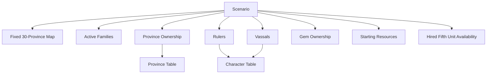

# Appendix B — Character and Scenario Data

## Purpose

Appendix B contains reference data for Gemfire characters and scenarios.

This appendix covers:

- scenario structure;
- active families by scenario;
- Gems by scenario;
- province ownership by scenario;
- playable families and difficulty notes;
- known ruler / lord data;
- character stat format;
- unresolved scenario data.

World geography belongs to Appendix A.

Military unit data belongs to Appendix C.

Commands and goodwill values belong to Appendix D.

Lore and narrative facts belong to Appendix E.

---

## B.1 Source Notes

### Main Data Sources

Scenario and character data is reconstructed primarily from:

- GameFAQs general / stats data;
- Andrew Que’s Gemfire Complete Guide;
- official manual scenario references;
- cross-checks against scenario pages and map data.

### Confidence Notes

The following data is high-confidence:

- four-scenario structure;
- 30-province map;
- province ownership table;
- major families by scenario;
- Gem ownership by scenario;
- most key rulers.

The following data still requires final verification:

- full lord / governor tables for Scenarios 2–4;
- version differences between Gemfire and Royal Blood.

Resolved since: the 64-general roster and stats, the Flax's Shame playable list
(Lyle / Blanche / Flax / Molbrew), and Tordin's Scenario-3 ruler (Gweyn) are now
established. Per-province starting stats and hire pools remain to be tabulated.

---

## B.2 Character Data Format

### Character Count

Gemfire contains 64 generals (confirmed). Each has INT / WAR / CHA, a birth year,
and an associated family; stats vary by scenario and with age.

Character data includes:

- name;
- family or associated house;
- birth year;
- INT / Domestic;
- WAR / Military;
- CHA / Charm;
- service status by scenario;
- province assignment by scenario.

---

### Recommended Character Record Format

| Field            | Description                                                  |
| ---------------- | ------------------------------------------------------------ |
| Name             | Character name.                                              |
| Family           | Original or associated family.                               |
| Birth            | Birth year.                                                  |
| INT              | Administrative / Domestic ability.                           |
| WAR              | Military ability.                                            |
| CHA              | Charm / Charisma.                                            |
| Scenario Service | Which family the character serves in each scenario.          |
| Province         | Province governed, if any.                                   |
| Notes            | Ruler, vassal, late arrival, family change, data issue, etc. |

---

### Recommended Full 64-General Table Format

The full character table should be maintained as structured data.

| Field  | Description                                           |
| ------ | ----------------------------------------------------- |
| Name   | Character name.                                       |
| Family | Associated family.                                    |
| Birth  | Birth year.                                           |
| S1 INT | Scenario 1 INT.                                       |
| S1 WAR | Scenario 1 WAR.                                       |
| S1 CHA | Scenario 1 CHA.                                       |
| S2 INT | Scenario 2 INT.                                       |
| S2 WAR | Scenario 2 WAR.                                       |
| S2 CHA | Scenario 2 CHA.                                       |
| S3 INT | Scenario 3 INT.                                       |
| S3 WAR | Scenario 3 WAR.                                       |
| S3 CHA | Scenario 3 CHA.                                       |
| S4 INT | Scenario 4 INT.                                       |
| S4 WAR | Scenario 4 WAR.                                       |
| S4 CHA | Scenario 4 CHA.                                       |
| Notes  | Ruler, vassal, late arrival, version difference, etc. |

---

## B.3 Families and Gems by Scenario

### Scenario 1 — Erin & Ander

| Family    | Head    | Gems    |
| --------- | ------- | ------- |
| Lankshire | Eselred | Dragon  |
| Blanche   | Erin    | Zendor  |
| Lyle      | Ander   | Pluvius |
| Coryll    | Lars    | Empyron |
| Chrysalis | Garth   | Chylla  |
| Flax      | Erik    | Scylla  |
| Molbrew   | Leander | Skulryk |

---

### Scenario 2 — Flax’s Shame

| Family    | Head    | Gems    |
| --------- | ------- | ------- |
| Lankshire | Eselred | Dragon  |
| Blanche   | Erin    | Zendor  |
| Lyle      | Ander   | Pluvius |
| Chrysalis | Elgis   | Chylla  |
| Flax      | Erik    | Scylla  |
| Molbrew   | Leander | Skulryk |
| Tate      | Terian  | Empyron |

---

### Scenario 3 — Terian’s War

| Family    | Head          | Gems            |
| --------- | ------------- | --------------- |
| Lankshire | Eselred       | Dragon          |
| Blanche   | Erin          | Zendor, Skulryk |
| Lyle      | Ander         | Pluvius, Chylla |
| Flax      | Erik          | Scylla          |
| Tate      | Terian        | Empyron         |
| Tordin    | Gweyn         | None            |

#### Data Note

Tordin's Scenario-3 ruler is **Gweyn** (Princess Gweyn of Tordin). Erven serves her
as lord of Cambry but is not of her house; the earlier "Erven / Gweyn" ambiguity is
resolved.

---

### Scenario 4 — Gemfire

| Family    | Head    | Gems            |
| --------- | ------- | --------------- |
| Lankshire | Eselred | Dragon          |
| Blanche   | Erin    | Zendor, Skulryk |
| Lyle      | Ander   | Pluvius, Chylla |
| Tate      | Terian  | Empyron         |
| Tudoria   | Eadric  | Scylla          |
| Divas     | Loryn   | None            |

---

## B.4 Playable Families and Difficulty Notes

### Scenario 1 — Erin & Ander

| Family    | Playable | Difficulty Notes        |
| --------- | -------- | ----------------------- |
| Blanche   | Yes      | Strong rebel start.     |
| Lyle      | Yes      | Strong rebel start.     |
| Coryll    | Yes      | Medium start.           |
| Chrysalis | Yes      | Difficult start.        |
| Lankshire | No       | Major royal antagonist. |
| Flax      | No       | Active family.          |
| Molbrew   | No       | Active family.          |

---

### Scenario 2 — Flax’s Shame

| Family    | Status | Notes                                       |
| --------- | ------ | ------------------------------------------- |
| Lankshire | Active | Royal house remains strong.                 |
| Blanche   | Active | Holds Zendor.                               |
| Lyle      | Active | Holds Pluvius.                              |
| Chrysalis | Active | Led by Elgis.                               |
| Flax      | Active | Defeated Coryll but has strategic pressure. |
| Molbrew   | Active | Still active in the mid-war map.            |
| Tate      | Active | New family created by Terian.               |

Playable families: Lyle, Blanche, Flax, Molbrew.

---

### Scenario 3 — Terian’s War

| Family    | Playable | Notes                            |
| --------- | -------- | -------------------------------- |
| Lyle      | Yes      | Strong northern / western bloc.  |
| Blanche   | Yes      | Strong rebel bloc.               |
| Tate      | Yes      | Two provinces, as in Scenario 2.  |
| Tordin    | Yes      | Minor / challenge-style start.   |
| Lankshire | Active   | Still central power.             |
| Flax      | Active   | Southwestern power.              |

---

### Scenario 4 — Gemfire

| Family    | Playable | Notes                    |
| --------- | -------- | ------------------------ |
| Lyle      | Yes      | Strong late-war start.   |
| Blanche   | Yes      | Strong late-war start.   |
| Tudoria   | Yes      | Holds Scylla.            |
| Divas     | Yes      | Challenge start, no Gem. |
| Lankshire | Active   | Weakened royal house.    |
| Tate      | Active   | Holds Empyron.           |

---

## B.5 Province Ownership by Scenario

|   # | Province | Erin & Ander | Flax’s Shame | Terian’s War | Gemfire   |
| --: | -------- | ------------ | ------------ | ------------ | --------- |
|   1 | Dunmoor  | Vacant       | Lyle         | Lyle         | Lyle      |
|   2 | Carveti  | Lyle         | Lyle         | Lyle         | Lyle      |
|   3 | Cobrige  | Blanche      | Lyle         | Blanche      | Blanche   |
|   4 | Banshea  | Blanche      | Blanche      | Blanche      | Blanche   |
|   5 | Petaria  | Blanche      | Blanche      | Blanche      | Blanche   |
|   6 | Hyland   | Lyle         | Blanche      | Blanche      | Blanche   |
|   7 | Norwood  | Lyle         | Lyle         | Lyle         | Lyle      |
|   8 | Lisle    | Chrysalis    | Chrysalis    | Lyle         | Lyle      |
|   9 | Erewood  | Vacant       | Molbrew      | Lyle         | Lyle      |
|  10 | Rodale   | Vacant       | Tate         | Lyle         | Blanche   |
|  11 | Hermet   | Lankshire    | Tate         | Blanche      | Blanche   |
|  12 | Ostlan   | Lankshire    | Blanche      | Blanche      | Blanche   |
|  13 | Powice   | Molbrew      | Molbrew      | Tate         | Lyle      |
|  14 | Cardyf   | Molbrew      | Molbrew      | Tate         | Tate      |
|  15 | Eljing   | Lankshire    | Lankshire    | Vacant       | Vacant    |
|  16 | Centra   | Lankshire    | Lankshire    | Lankshire    | Vacant    |
|  17 | Culver   | Lankshire    | Lankshire    | Lankshire    | Divas     |
|  18 | Lindum   | Lankshire    | Lankshire    | Lankshire    | Divas     |
|  19 | Caster   | Lankshire    | Lankshire    | Lankshire    | Lankshire |
|  20 | Anglia   | Lankshire    | Lankshire    | Lankshire    | Lankshire |
|  21 | Oldlyn   | Lankshire    | Lankshire    | Lankshire    | Vacant    |
|  22 | Londre   | Lankshire    | Lankshire    | Lankshire    | Lankshire |
|  23 | Attley   | Lankshire    | Lankshire    | Vacant       | Tate      |
|  24 | Linden   | Flax         | Lankshire    | Flax         | Tate      |
|  25 | Ashlan   | Coryll       | Flax         | Flax         | Tudoria   |
|  26 | Penzan   | Coryll       | Flax         | Flax         | Tudoria   |
|  27 | Belgam   | Flax         | Flax         | Flax         | Tudoria   |
|  28 | Celsea   | Lankshire    | Lankshire    | Lankshire    | Lankshire |
|  29 | Cambry   | Lankshire    | Lankshire    | Tordin       | Vacant    |
|  30 | Farlan   | Lankshire    | Lankshire    | Tordin       | Vacant    |

---

## B.6 Lord Tables

The tables cover all four scenarios.

"Direct rule" means the province is owned but has no general in it; it then uses half the ruler's stats. Vassals at a ruler's court are not listed.

### Scenario 1 — Erin & Ander

| Province | Family | Leader | Role |
| --- | --- | --- | --- |
| 1 Dunmoor | — | Unowned | — |
| 2 Carveti | Lyle | Ander | Ruler |
| 3 Cobrige | Blanche | Roland | Lord |
| 4 Banshea | Blanche | Karl | Lord |
| 5 Petaria | Blanche | Erin | Ruler |
| 6 Hyland | Lyle | Seth | Lord |
| 7 Norwood | Lyle | Wolfen | Lord |
| 8 Lisle | Chrysalis | Garth | Ruler |
| 9 Erewood | — | Unowned | — |
| 10 Rodale | — | Unowned | — |
| 11 Hermet | Lankshire | Terian | Lord |
| 12 Ostlan | Lankshire | Regis | Lord |
| 13 Powice | Molbrew | Leander | Ruler |
| 14 Cardyf | Molbrew | Fuster | Lord |
| 15 Eljing | Lankshire | Adryl | Lord |
| 16 Centra | Lankshire | Direct rule | — |
| 17 Culver | Lankshire | Loryn | Lord |
| 18 Lindum | Lankshire | Direct rule | — |
| 19 Caster | Lankshire | Colin | Lord |
| 20 Anglia | Lankshire | Direct rule | — |
| 21 Oldlyn | Lankshire | Direct rule | — |
| 22 Londre | Lankshire | Eselred | Ruler |
| 23 Attley | Lankshire | Carlyle | Lord |
| 24 Linden | Flax | Direct rule | — |
| 25 Ashlan | Coryll | Lars | Ruler |
| 26 Penzan | Coryll | Erven | Lord |
| 27 Belgam | Flax | Erik | Ruler |
| 28 Celsea | Lankshire | Direct rule | — |
| 29 Cambry | Lankshire | Shabard | Lord |
| 30 Farlan | Lankshire | Direct rule | — |

---

### Scenario 2 — Flax’s Shame

| Province | Family | Leader | Role |
| --- | --- | --- | --- |
| 1 Dunmoor | Lyle | Direct rule | — |
| 2 Carveti | Lyle | Ander | Ruler |
| 3 Cobrige | Lyle | Wolfen | Lord |
| 4 Banshea | Blanche | Karl | Lord |
| 5 Petaria | Blanche | Erin | Ruler |
| 6 Hyland | Blanche | Pender | Lord |
| 7 Norwood | Lyle | Kneulf | Lord |
| 8 Lisle | Chrysalis | Elgis | Ruler |
| 9 Erewood | Molbrew | Fuster | Lord |
| 10 Rodale | Tate | Bryan | Lord |
| 11 Hermet | Tate | Terian | Ruler |
| 12 Ostlan | Blanche | Direct rule | — |
| 13 Powice | Molbrew | Leander | Ruler |
| 14 Cardyf | Molbrew | Direct rule | — |
| 15 Eljing | Lankshire | Adryl | Lord |
| 16 Centra | Lankshire | Direct rule | — |
| 17 Culver | Lankshire | Loryn | Lord |
| 18 Lindum | Lankshire | Direct rule | — |
| 19 Caster | Lankshire | Colin | Lord |
| 20 Anglia | Lankshire | Direct rule | — |
| 21 Oldlyn | Lankshire | Direct rule | — |
| 22 Londre | Lankshire | Eselred | Ruler |
| 23 Attley | Lankshire | Direct rule | — |
| 24 Linden | Lankshire | Direct rule | — |
| 25 Ashlan | Flax | Jerras | Lord |
| 26 Penzan | Flax | Direct rule | — |
| 27 Belgam | Flax | Erik | Ruler |
| 28 Celsea | Lankshire | Direct rule | — |
| 29 Cambry | Lankshire | Shabard | Lord |
| 30 Farlan | Lankshire | Direct rule | — |

---

### Scenario 3 — Terian’s War

| Province | Family | Leader | Role |
| --- | --- | --- | --- |
| 1 Dunmoor | Lyle | Direct rule | — |
| 2 Carveti | Lyle | Walther | Lord |
| 3 Cobrige | Blanche | Karl | Lord |
| 4 Banshea | Blanche | Direct rule | — |
| 5 Petaria | Blanche | Erin | Ruler |
| 6 Hyland | Blanche | Pender | Lord |
| 7 Norwood | Lyle | Ander | Ruler |
| 8 Lisle | Lyle | Randal | Lord |
| 9 Erewood | Lyle | Direct rule | — |
| 10 Rodale | Lyle | Wolfen | Lord |
| 11 Hermet | Blanche | Sven | Lord |
| 12 Ostlan | Blanche | Arkin | Lord |
| 13 Powice | Tate | Bryan | Lord |
| 14 Cardyf | Tate | Terian | Ruler |
| 15 Eljing | — | Unowned | — |
| 16 Centra | Lankshire | Adryl | Lord |
| 17 Culver | Lankshire | Loryn | Lord |
| 18 Lindum | Lankshire | Geoff | Lord |
| 19 Caster | Lankshire | Colin | Lord |
| 20 Anglia | Lankshire | Direct rule | — |
| 21 Oldlyn | Lankshire | Hubert | Lord |
| 22 Londre | Lankshire | Eselred | Ruler |
| 23 Attley | — | Unowned | — |
| 24 Linden | Flax | Jerras | Lord |
| 25 Ashlan | Flax | Kelvin | Lord |
| 26 Penzan | Flax | Direct rule | — |
| 27 Belgam | Flax | Erik | Ruler |
| 28 Celsea | Lankshire | Shabard | Lord |
| 29 Cambry | Tordin | Erven | Lord |
| 30 Farlan | Tordin | Gweyn | Ruler |

---

### Scenario 4 — Gemfire

| Province | Family | Leader | Role |
| --- | --- | --- | --- |
| 1 Dunmoor | Lyle | Keyla | Lord |
| 2 Carveti | Lyle | Andrew | Lord |
| 3 Cobrige | Blanche | Owen | Lord |
| 4 Banshea | Blanche | Gweyn | Lord |
| 5 Petaria | Blanche | Karl | Lord |
| 6 Hyland | Blanche | Erin | Ruler |
| 7 Norwood | Lyle | Wolfen | Lord |
| 8 Lisle | Lyle | Walther | Lord |
| 9 Erewood | Lyle | Adryl | Lord |
| 10 Rodale | Blanche | Geran | Lord |
| 11 Hermet | Blanche | Direct rule | — |
| 12 Ostlan | Blanche | Direct rule | — |
| 13 Powice | Lyle | Ander | Ruler |
| 14 Cardyf | Tate | Terian | Ruler |
| 15 Eljing | — | Unowned | — |
| 16 Centra | — | Unowned | — |
| 17 Culver | Divas | Loryn | Ruler |
| 18 Lindum | Divas | Raith | Lord |
| 19 Caster | Lankshire | Pender | Lord |
| 20 Anglia | Lankshire | Shabard | Lord |
| 21 Oldlyn | — | Unowned | — |
| 22 Londre | Lankshire | Eselred | Ruler |
| 23 Attley | Tate | Bryan | Lord |
| 24 Linden | Tate | Galford | Lord |
| 25 Ashlan | Tudoria | Eadric | Ruler |
| 26 Penzan | Tudoria | Kelvin | Lord |
| 27 Belgam | Tudoria | Alex | Lord |
| 28 Celsea | Lankshire | Hubert | Lord |
| 29 Cambry | — | Unowned | — |
| 30 Farlan | — | Unowned | — |

---

## B.7 Rulers by Scenario

| Scenario     | Family    | Ruler         |
| ------------ | --------- | ------------- |
| Erin & Ander | Lankshire | Eselred       |
| Erin & Ander | Blanche   | Erin          |
| Erin & Ander | Lyle      | Ander         |
| Erin & Ander | Coryll    | Lars          |
| Erin & Ander | Chrysalis | Garth         |
| Erin & Ander | Flax      | Erik          |
| Erin & Ander | Molbrew   | Leander       |
| Flax’s Shame | Lankshire | Eselred       |
| Flax’s Shame | Blanche   | Erin          |
| Flax’s Shame | Lyle      | Ander         |
| Flax’s Shame | Chrysalis | Elgis         |
| Flax’s Shame | Flax      | Erik          |
| Flax’s Shame | Molbrew   | Leander       |
| Flax’s Shame | Tate      | Terian        |
| Terian’s War | Lankshire | Eselred       |
| Terian’s War | Blanche   | Erin          |
| Terian’s War | Lyle      | Ander         |
| Terian’s War | Flax      | Erik          |
| Terian’s War | Tate      | Terian        |
| Terian’s War | Tordin    | Gweyn         |
| Gemfire      | Lankshire | Eselred       |
| Gemfire      | Blanche   | Erin          |
| Gemfire      | Lyle      | Ander         |
| Gemfire      | Tate      | Terian        |
| Gemfire      | Tudoria   | Eadric        |
| Gemfire      | Divas     | Loryn         |

---

## B.8 Character Continuity Notes

This section records only data-relevant continuity cases.

It should not be expanded into personality or ideology notes unless supported by explicit narrative sources.

| Character | Data Note                                                                           |
| --------- | ----------------------------------------------------------------------------------- |
| Erin      | Ruler of Blanche across all scenarios.                                              |
| Ander     | Ruler of Lyle across all scenarios.                                                 |
| Eselred   | Ruler of Lankshire across all scenarios.                                            |
| Terian    | Lankshire-associated in early data; later ruler of Tate.                            |
| Loryn     | Lankshire-associated in early data; later ruler of Divas.                           |
| Erven     | Coryll lord in Scenario 1; Molbrew vassal in Scenario 2; Tordin lord of Cambry in Scenario 3; absent in Scenario 4. Never a member of a ruling house, and not Tordin's ruler (that is Gweyn). |
| Eadric    | Ruler of Tudoria in Scenario 4.                                                     |
| Pender    | Blanche-associated in earlier data; later involved in Scenario 4 political changes. |

---

## B.9 Extended Scenario State Tables

Sections B.11–B.13 add character data. Starting province resources and hire pools are held in `data/scenario-1.json` … `data/scenario-4.json` under Gemstorm’s names. The Tordin block of Scenario 3 differs from the values described in B.13. Stored values represent the state one month before play begins.

### Not Included in This Version

The following data is not included in this version of Appendix B:

- starting Gold per province;
- starting Food per province;
- starting Troops per province;
- starting Loyalty;
- starting Cultivation;
- starting Protection;
- starting Hired Fifth Units;
- province-specific hire pools.

These per-province, per-scenario values remain to be tabulated in a future
revision.

---

### Recommended Future Format

| Scenario | Province | Owner | Lord | Gold | Food | Troops | Loyalty | Cultivation | Protection | Fifth Unit |
| -------- | -------- | ----- | ---- | ---: | ---: | -----: | ------: | ----------: | ---------: | ---------- |

This table should be maintained separately or generated from structured data.

---

## B.10 Scenario Data Summary

### Scenario Data Model

---

### Key Data Facts

The most important confirmed scenario data includes:

- active families and rulers by scenario (scenario structure and timeline: see §12.3);
- Gems held by each family;
- full province ownership by scenario;
- key character continuity cases;
- the existence of 64 generals with scenario-specific stats and service data.

---

## B.11 General Records

These values never change during play.

- **Base age:** age at the start of Scenario 1 is base age + 1; Scenarios 2, 3, and 4 add 6, 11, and 16.
- **Defection class:** chance to accept a defection offer once its conditions are met — 0: 3%, 1: 15%, 2: 30%, 3: 50%.
- **Recruit class:** Fame the captor's ruler needs to recruit him as a prisoner — 0: 51, 1: 31, 2: 16, 3: none.

See [General Loyalty](./05-characters.md#detailed-rules-general-loyalty) and [Prisoners](./05-characters.md#detailed-rules-prisoners).

| # | General | Base age | Defection class | Recruit class | Scenarios |
| --: | --- | --: | --: | --: | --- |
| 1 | Ander | 20 | 0 | 0 | 1,2,3,4 |
| 2 | Colin | 25 | 0 | 1 | 1,2,3 |
| 3 | Loryn | 30 | 2 | 1 | 1,2,3,4 |
| 4 | Bryan | 11 | 0 | 1 | 2,3,4 |
| 5 | Erin | 18 | 0 | 0 | 1,2,3,4 |
| 6 | Hubert | 10 | 1 | 2 | 2,3,4 |
| 7 | Geoff | 9 | 1 | 2 | 2,3,4 |
| 8 | Roland | 43 | 0 | 1 | 1,2,3,4 |
| 9 | Terian | 27 | 2 | 1 | 1,2,3,4 |
| 10 | Seth | 46 | 1 | 1 | 1,2,3,4 |
| 11 | Erik | 41 | 1 | 2 | 1,2,3 |
| 12 | Regis | 52 | 1 | 2 | 1,2 |
| 13 | Oswald | 26 | 0 | 2 | 1,2 |
| 14 | Griff | 15 | 1 | 2 | 1,2 |
| 15 | Adryl | 19 | 3 | 3 | 1,2,3,4 |
| 16 | Eadric | 10 | 0 | 1 | 4 |
| 17 | Karl | 20 | 1 | 2 | 1,2,3,4 |
| 18 | Carlyle | 52 | 0 | 3 | 1 |
| 19 | Erven | 43 | 0 | 2 | 1,2,3 |
| 20 | Pender | 16 | 3 | 1 | 1,2,3,4 |
| 21 | Geolug | 36 | 0 | 0 | 1,2,3,4 |
| 22 | Owen | 15 | 1 | 3 | 3,4 |
| 23 | Leander | 47 | 1 | 3 | 1,2 |
| 24 | Elgis | 22 | 2 | 2 | 1,2 |
| 25 | Jerras | 25 | 2 | 3 | 1,2,3,4 |
| 26 | Garth | 47 | 2 | 2 | 1 |
| 27 | Kelvin | 13 | 2 | 3 | 3,4 |
| 28 | Lars | 25 | 1 | 3 | 1 |
| 29 | Alain | 22 | 3 | 3 | 3,4 |
| 30 | Eselred | 37 | 0 | 0 | 1,2,3,4 |
| 31 | Wolfen | 19 | 1 | 2 | 1,2,3,4 |
| 32 | Elford | 9 | 0 | 2 | 2,3,4 |
| 33 | Alex | 7 | 0 | 1 | 3,4 |
| 34 | Gerard | 15 | 1 | 3 | 2,3 |
| 35 | Karla | 32 | 0 | 0 | 1,2,3,4 |
| 36 | Anise | 4 | 1 | 1 | 3,4 |
| 37 | Shabard | 23 | 0 | 2 | 1,2,3,4 |
| 38 | Sven | 46 | 3 | 2 | 2,3 |
| 39 | Fuster | 22 | 2 | 3 | 1,2 |
| 40 | Anselm | 14 | 0 | 2 | 1,2 |
| 41 | Galford | 2 | 3 | 2 | 4 |
| 42 | Cairn | 14 | 2 | 3 | 4 |
| 43 | Esok | 26 | 2 | 2 | 1,2 |
| 44 | Eustace | 29 | 1 | 2 | 1,2,3 |
| 45 | Aiden | 27 | 3 | 3 | 1,2,3,4 |
| 46 | Veen | 20 | 1 | 3 | 3,4 |
| 47 | Lenne | 28 | 2 | 3 | 1,2 |
| 48 | Aigle | 57 | 1 | 2 | 1 |
| 49 | Raith | 18 | 3 | 1 | 2,3,4 |
| 50 | Walther | 13 | 2 | 3 | 3,4 |
| 51 | Elias | 16 | 1 | 3 | 3,4 |
| 52 | Nicolay | 35 | 2 | 3 | 1,2 |
| 53 | Bradley | 20 | 3 | 3 | 3,4 |
| 54 | Sarthe | 25 | 1 | 3 | 1,2 |
| 55 | Randal | 19 | 2 | 3 | 3 |
| 56 | Melgan | 28 | 1 | 2 | 2,3,4 |
| 57 | Francis | 51 | 2 | 3 | 1,2 |
| 58 | Seagal | 10 | 2 | 3 | 3,4 |
| 59 | Andrew | 6 | 2 | 3 | 3,4 |
| 60 | Kneulf | 42 | 1 | 3 | 1,2 |
| 61 | Arkin | 9 | 3 | 3 | 2,3 |
| 62 | Keyla | 10 | 0 | 1 | 2,3,4 |
| 63 | Gweyn | 10 | 0 | 1 | 3,4 |
| 64 | Geran | 11 | 0 | 1 | 2,3,4 |

---

## B.12 General Stats by Scenario

INT / WAR / CHA as stored in each start image. "—" means the general is not in that scenario.

Stats are stored separately for each scenario and do not only rise: older characters decline between scenarios.

| General | Scenario 1 | Scenario 2 | Scenario 3 | Scenario 4 |
| --- | --- | --- | --- | --- |
| Ander | 88 / 85 / 74 | 90 / 86 / 76 | 93 / 88 / 77 | 95 / 89 / 79 |
| Colin | 85 / 73 / 88 | 86 / 76 / 89 | 89 / 77 / 90 | — |
| Loryn | 77 / 89 / 75 | 79 / 91 / 76 | 81 / 91 / 79 | 82 / 93 / 77 |
| Bryan | — | 86 / 75 / 71 | 89 / 77 / 74 | 91 / 81 / 75 |
| Erin | 82 / 87 / 76 | 83 / 90 / 77 | 85 / 91 / 79 | 87 / 94 / 80 |
| Hubert | — | 73 / 84 / 81 | 75 / 85 / 82 | 76 / 87 / 82 |
| Geoff | — | 84 / 73 / 74 | 86 / 74 / 76 | 89 / 75 / 77 |
| Roland | 75 / 88 / 85 | 76 / 86 / 85 | 76 / 85 / 86 | 78 / 81 / 84 |
| Terian | 77 / 80 / 76 | 78 / 80 / 74 | 80 / 82 / 75 | 81 / 84 / 77 |
| Seth | 86 / 77 / 70 | 87 / 78 / 72 | 87 / 77 / 72 | 88 / 73 / 74 |
| Erik | 80 / 74 / 70 | 81 / 76 / 71 | 83 / 77 / 82 | — |
| Regis | 80 / 70 / 75 | 82 / 73 / 76 | — | — |
| Oswald | 73 / 82 / 68 | 75 / 83 / 69 | — | — |
| Griff | 69 / 84 / 76 | 70 / 86 / 77 | — | — |
| Adryl | 70 / 82 / 45 | 72 / 83 / 48 | 74 / 86 / 49 | 76 / 87 / 51 |
| Eadric | — | — | — | 93 / 68 / 96 |
| Karl | 76 / 57 / 77 | 78 / 59 / 78 | 81 / 60 / 80 | 84 / 62 / 81 |
| Carlyle | 66 / 72 / 70 | — | — | — |
| Erven | 58 / 65 / 78 | 60 / 66 / 79 | 61 / 68 / 80 | — |
| Pender | 74 / 89 / 31 | 75 / 91 / 28 | 78 / 94 / 25 | 80 / 96 / 23 |
| Geolug | 98 / 89 / 68 | 96 / 88 / 66 | 95 / 86 / 63 | 93 / 85 / 62 |
| Owen | — | — | 64 / 84 / 63 | 65 / 87 / 66 |
| Leander | 65 / 60 / 67 | 68 / 64 / 69 | — | — |
| Elgis | 56 / 93 / 35 | 60 / 95 / 38 | — | — |
| Jerras | 67 / 45 / 71 | 69 / 49 / 72 | 70 / 48 / 74 | 68 / 45 / 72 |
| Garth | 52 / 67 / 58 | — | — | — |
| Kelvin | — | — | 71 / 68 / 70 | 73 / 70 / 74 |
| Lars | 78 / 72 / 69 | — | — | — |
| Alain | — | — | 58 / 52 / 76 | 60 / 54 / 77 |
| Eselred | 39 / 35 / 58 | 41 / 36 / 56 | 42 / 38 / 55 | 44 / 40 / 51 |
| Wolfen | 62 / 90 / 61 | 64 / 91 / 63 | 65 / 93 / 65 | 66 / 94 / 67 |
| Elford | — | 65 / 71 / 67 | 67 / 72 / 68 | 69 / 74 / 71 |
| Alex | — | — | 61 / 72 / 70 | 65 / 76 / 77 |
| Gerard | — | 62 / 71 / 58 | 63 / 74 / 60 | — |
| Karla | 65 / 42 / 81 | 67 / 43 / 79 | 69 / 43 / 77 | 71 / 44 / 72 |
| Anise | — | — | 72 / 18 / 80 | 72 / 18 / 80 |
| Shabard | 50 / 73 / 56 | 51 / 75 / 57 | 52 / 77 / 60 | 54 / 78 / 62 |
| Sven | — | 52 / 88 / 46 | 51 / 87 / 49 | — |
| Fuster | 53 / 72 / 55 | 55 / 75 / 58 | — | — |
| Anselm | 76 / 52 / 75 | 81 / 55 / 78 | — | — |
| Galford | — | — | — | 62 / 78 / 53 |
| Cairn | — | — | — | 56 / 62 / 57 |
| Esok | 51 / 64 / 55 | 53 / 65 / 57 | — | — |
| Eustace | 62 / 57 / 53 | 62 / 60 / 55 | 63 / 62 / 58 | — |
| Aiden | 52 / 71 / 41 | 53 / 70 / 40 | 54 / 72 / 40 | 56 / 73 / 38 |
| Veen | — | — | 71 / 58 / 32 | 74 / 60 / 35 |
| Lenne | 48 / 57 / 56 | 50 / 60 / 58 | — | — |
| Aigle | 50 / 55 / 55 | — | — | — |
| Raith | — | 33 / 89 / 40 | 33 / 91 / 38 | 32 / 94 / 36 |
| Walther | — | — | 39 / 71 / 45 | 40 / 72 / 47 |
| Elias | — | — | 46 / 42 / 68 | 48 / 45 / 70 |
| Nicolay | 46 / 51 / 57 | 48 / 54 / 60 | — | — |
| Bradley | — | — | 46 / 70 / 38 | 48 / 74 / 35 |
| Sarthe | 48 / 39 / 62 | 50 / 42 / 63 | — | — |
| Randal | — | — | 35 / 52 / 61 | — |
| Melgan | — | 41 / 78 / 57 | 42 / 80 / 60 | 44 / 84 / 63 |
| Francis | 37 / 48 / 55 | 39 / 50 / 56 | — | — |
| Seagal | — | — | 38 / 42 / 59 | 40 / 43 / 60 |
| Andrew | — | — | 42 / 56 / 39 | 45 / 60 / 41 |
| Kneulf | 41 / 56 / 37 | 45 / 60 / 42 | — | — |
| Arkin | — | 29 / 44 / 48 | 31 / 47 / 50 | — |
| Keyla | — | 53 / 78 / 81 | 55 / 81 / 83 | 58 / 84 / 86 |
| Gweyn | — | — | 76 / 58 / 82 | 82 / 55 / 86 |
| Geran | — | 38 / 85 / 53 | 40 / 86 / 55 | 43 / 89 / 56 |

---

## B.13 Starting Fame, Gems, and House Members

Starting values for each scenario.

- **Fame** is 3 × provinces owned in every case.
- **House members** are the generals who can inherit and who never defect ([General Loyalty](./05-characters.md#detailed-rules-general-loyalty), [Succession](./05-characters.md#detailed-rules-succession)). A family with none has no heir.
- Each Gem is named by its Guardian. The Dragon is the seventh Gem.

| Scenario | Family | Ruler | Provinces | Fame | Gems | House members |
| --- | --- | --- | --: | --: | --- | --- |
| 1 | Lankshire | Eselred | 14 | 42 | Dragon | Adryl, Karla |
| 1 | Blanche | Erin | 3 | 9 | Zendor | Karl, Pender, Anselm |
| 1 | Lyle | Ander | 3 | 9 | Pluvius | Wolfen |
| 1 | Coryll | Lars | 2 | 6 | Empyron | None |
| 1 | Chrysalis | Garth | 1 | 3 | Chylla | Elgis, Sarthe |
| 1 | Flax | Erik | 2 | 6 | Scylla | None |
| 1 | Molbrew | Leander | 2 | 6 | Skulryk | Fuster |
| 2 | Lankshire | Eselred | 13 | 39 | Dragon | Adryl, Elford, Karla |
| 2 | Blanche | Erin | 4 | 12 | Zendor | Karl, Pender, Anselm, Arkin |
| 2 | Lyle | Ander | 4 | 12 | Pluvius | Wolfen, Keyla |
| 2 | Chrysalis | Elgis | 1 | 3 | Chylla | Sarthe |
| 2 | Flax | Erik | 3 | 9 | Scylla | None |
| 2 | Molbrew | Leander | 3 | 9 | Skulryk | Fuster |
| 2 | Tate | Terian | 2 | 6 | Empyron | Bryan |
| 3 | Lankshire | Eselred | 8 | 24 | Dragon | Adryl, Elford, Karla |
| 3 | Blanche | Erin | 6 | 18 | Zendor, Skulryk | Karl, Pender, Arkin |
| 3 | Lyle | Ander | 6 | 18 | Pluvius, Chylla | Wolfen, Randal, Keyla |
| 3 | Flax | Erik | 4 | 12 | Scylla | Elias |
| 3 | Tate | Terian | 2 | 6 | Empyron | Bryan, Anise |
| 3 | Tordin | Gweyn | 2 | 6 | None | Alex |
| 4 | Lankshire | Eselred | 4 | 12 | Dragon | Elford, Karla |
| 4 | Blanche | Erin | 7 | 21 | Zendor, Skulryk | Karl |
| 4 | Lyle | Ander | 6 | 18 | Pluvius, Chylla | Wolfen, Keyla |
| 4 | Tate | Terian | 3 | 9 | Empyron | Bryan, Anise, Galford |
| 4 | Tudoria | Eadric | 3 | 9 | Scylla | None |
| 4 | Divas | Loryn | 2 | 6 | None | None |

In Scenario 3, Tordin is led by Gweyn. Erven is her lord at Cambry and Alex is at her court.

---

Starting province resources, stats and hire pools are described in the scenario data; their correspondence across versions and the handling of changing family affiliations remain unverified.

## Summary

Appendix B defines Gemfire’s political and character data structure.

It currently includes:

- active families and rulers by scenario;
- Gem ownership by scenario;
- province ownership by scenario;
- known lord data;
- recommended full character table format;
- scenario data gaps.

This appendix should eventually become the central reference for all scenario and character tables.
