# Prototype Building Roster

Each image below is a canonical visual reference for the current prototype. All icon files are 128×128 WebP, displayed here at 64×64.

## Settlement

Mandatory building in the dedicated Settlement slot. Defines planet development level, unlocks regular building slots, and provides a small base income.

| I                                                                    | II                                                                     | III                                                                      | IV                                                                     | V                                                                    |
| -------------------------------------------------------------------- | ---------------------------------------------------------------------- | ------------------------------------------------------------------------ | ---------------------------------------------------------------------- | -------------------------------------------------------------------- |
|  |  | 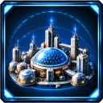 | 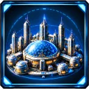 | 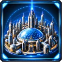 |

Main planets may reach V. Secondary planets may reach III.

## Agriculture

Produces Food for the system. Food output from multiple planets is additive.

| I                                                                      | II                                                                       | III                                                                        |
| ---------------------------------------------------------------------- | ------------------------------------------------------------------------ | -------------------------------------------------------------------------- |
| 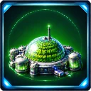 | 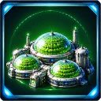 | 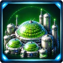 |

## Economy

Produces Money. Income from multiple economic buildings is additive.

| I                                                              | II                                                               | III                                                                |
| -------------------------------------------------------------- | ---------------------------------------------------------------- | ------------------------------------------------------------------ |
| 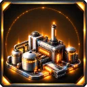 | 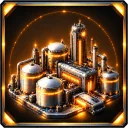 | 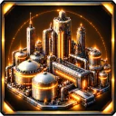 |

## Light Shipyard

Unlocks ships from the Light branch for recruitment and replenishment across the system.

| I                                                                            | II                                                                             | III                                                                              |
| ---------------------------------------------------------------------------- | ------------------------------------------------------------------------------ | -------------------------------------------------------------------------------- |
| 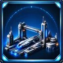 | 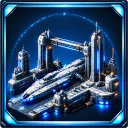 | 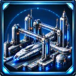 |

## Strike Shipyard

Unlocks ships from the Strike branch for recruitment and replenishment across the system.

| I                                                                              | II                                                                               | III                                                                                | IV                                                                               |
| ------------------------------------------------------------------------------ | -------------------------------------------------------------------------------- | ---------------------------------------------------------------------------------- | -------------------------------------------------------------------------------- |
| 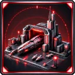 | 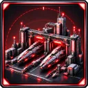 | 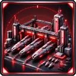 | 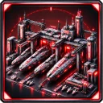 |

## Line Shipyard

Unlocks ships from the Line branch for recruitment and replenishment across the system.

| II | III | IV | V |
| --- | --- | --- | --- |
| 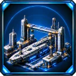 | 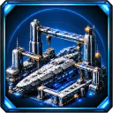 | 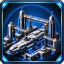 | 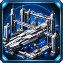 |

The chain begins at level II, constructed directly at that level and unlocking the Cruiser.

## Carrier Complex

Unlocks ships from the Carrier branch for recruitment and replenishment across the system.

| II | III | V |
| --- | --- | --- |
| 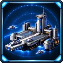 | 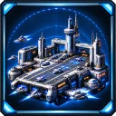 | 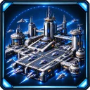 |

The chain begins at level II and upgrades from II to III, then directly to V. Level V unlocks the Fleet Carrier.
