# Prototype Ship Roster

Names and image mapping in this document are canonical for the current prototype art. Numeric balance values are canonical in [prototype-ships.json](prototype-ships.json).

## Overview

`#` matches the numeric prefix of the ship's image file. Level is the level of the chain's military building that unlocks the ship.

| #   | Ship              | Chain   | Level | Role                                 |
| --- | ----------------- | ------- | ----: | ------------------------------------ |
| 1   | Corvette          | Light   |     1 | cheap fast generalist                |
| 2   | Frigate           | Light   |     2 | escort / point defence               |
| 3   | Destroyer         | Light   |     3 | heavy escort / anti-light            |
| 4   | Gunship           | Strike  |     1 | cheap glass cannon                   |
| 5   | Torpedo Ship      | Strike  |     2 | anti-heavy / anti-capital specialist |
| 6   | Missile Destroyer | Strike  |     3 | long-range strike support            |
| 7   | Artillery Cruiser | Strike  |     4 | heavy long-range fire support        |
| 8   | Cruiser           | Line    |     2 | universal line ship                  |
| 9   | Heavy Cruiser     | Line    |     3 | durable line ship                    |
| 10  | Battlecruiser     | Line    |     4 | fast heavy striker                   |
| 11  | Battleship        | Line    |     5 | maximum direct power and durability  |
| 12  | Light Carrier     | Carrier |     2 | entry carrier platform               |
| 13  | Carrier           | Carrier |     3 | standard strike-craft platform       |
| 14  | Fleet Carrier     | Carrier |     5 | late-game capital carrier            |

## Light Chain

### Corvette

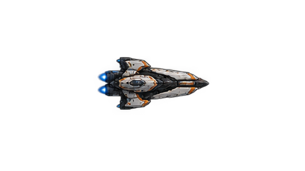

Unlocked by [Light Shipyard I](../buildings/building-roster.md#light-shipyard). Cheap fast generalist. Low cost and upkeep keep it useful when raw combat power is not worth paying for.

### Frigate

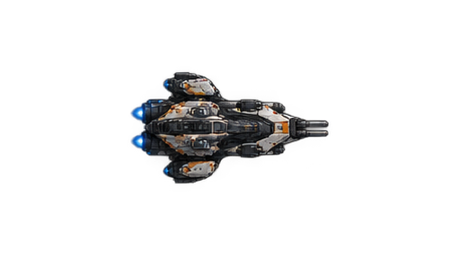

Unlocked by [Light Shipyard II](../buildings/building-roster.md#light-shipyard). Escort. Provides point defence against missiles, torpedoes, and strike craft.

### Destroyer

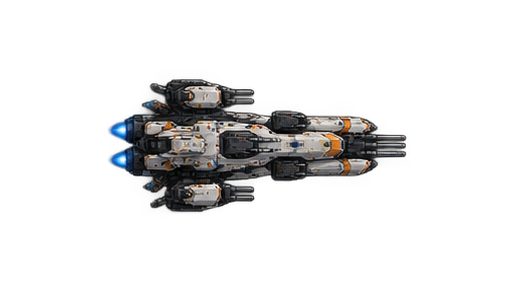

Unlocked by [Light Shipyard III](../buildings/building-roster.md#light-shipyard). Heavy escort. Stronger anti-light fire and point defence than the Frigate.

## Strike Chain

### Gunship

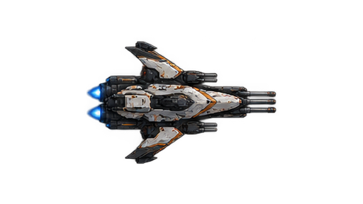

Unlocked by [Strike Shipyard I](../buildings/building-roster.md#strike-shipyard). Cheap glass cannon. High direct damage for its cost and low durability.

### Torpedo Ship

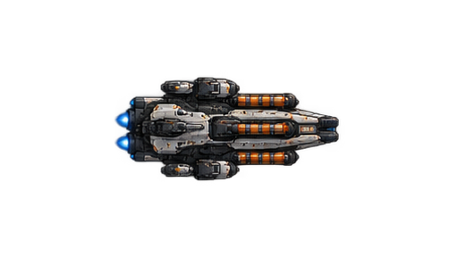

Unlocked by [Strike Shipyard II](../buildings/building-roster.md#strike-shipyard). Close-range specialist against heavy and capital ships. Poor against small evasive targets and vulnerable to point defence.

### Missile Destroyer

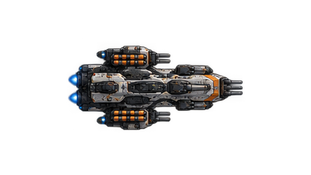

Unlocked by [Strike Shipyard III](../buildings/building-roster.md#strike-shipyard). Long-range strike support. Deals damage before fleets close but is vulnerable to point defence.

### Artillery Cruiser

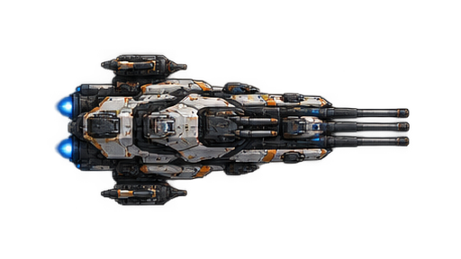

Unlocked by [Strike Shipyard IV](../buildings/building-roster.md#strike-shipyard). Heavy long-range fire support. Strong at distance and weaker after the battle closes.

## Line Chain

### Cruiser

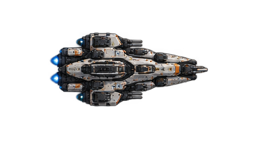

Unlocked by [Line Shipyard II](../buildings/building-roster.md#line-shipyard). Universal line ship. Balanced offense, durability, and speed without a strong specialization.

### Heavy Cruiser

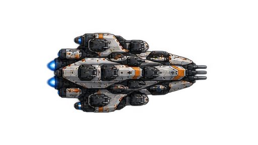

Unlocked by [Line Shipyard III](../buildings/building-roster.md#line-shipyard). Durable line ship. Trades speed and cost for staying power.

### Battlecruiser

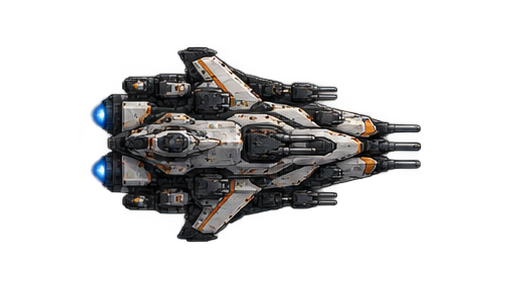

Unlocked by [Line Shipyard IV](../buildings/building-roster.md#line-shipyard). Fast heavy striker. High damage while retaining much better strategic speed than a Battleship.

### Battleship

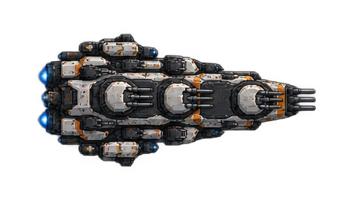

Unlocked by [Line Shipyard V](../buildings/building-roster.md#line-shipyard). Maximum direct-combat power and durability. Very expensive to recruit and maintain, slow, and attractive to dedicated anti-capital weapons.

## Carrier Chain

### Light Carrier

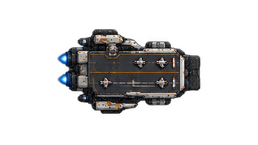

Unlocked by [Carrier Complex II](../buildings/building-roster.md#carrier-complex). Entry carrier platform. Provides early access to strike craft.

### Carrier

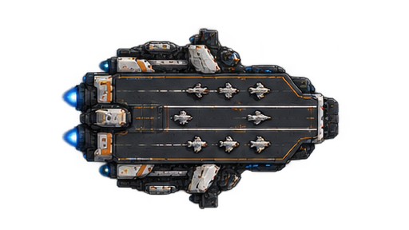

Unlocked by [Carrier Complex III](../buildings/building-roster.md#carrier-complex). Standard strike-craft platform. Relies on fleet protection rather than direct combat strength.

### Fleet Carrier

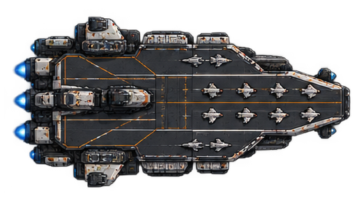

Unlocked by [Carrier Complex V](../buildings/building-roster.md#carrier-complex). Late-game capital carrier. Maximum strike-craft output at very high cost and upkeep.
