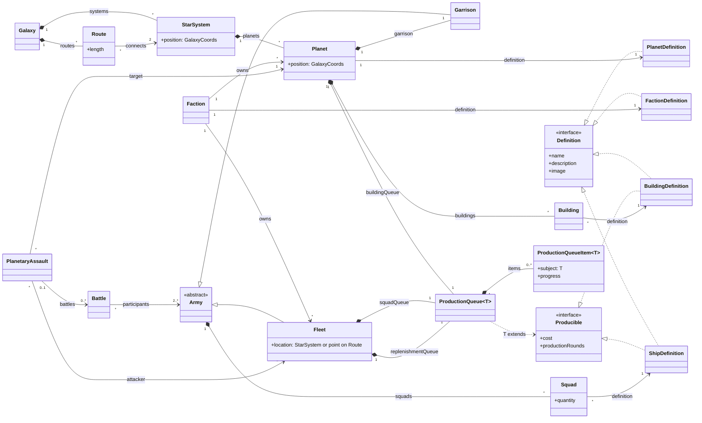

# Total Space — Domain Model

This document describes the domain entities of Total Space and their relationships.

## 1. Domain Glossary

| Term                  | Meaning                                                                                                                                        |
| --------------------- | ---------------------------------------------------------------------------------------------------------------------------------------------- |
| `Galaxy`              | The strategic space in which the campaign takes place. It contains star systems and everything located within them or travelling between them. |
| `StarSystem`          | A stellar system containing one or more planets.                                                                                               |
| `Route`               | A travel path linking exactly two star systems. Fleets move only along routes.                                                                 |
| `Planet`              | A world that can be owned, developed, defended, and conquered. Each planet belongs to one star system and has its own location in the galaxy.  |
| `Faction`             | A political power participating in the campaign. A faction owns planets and fleets.                                                            |
| `Building`            | A facility constructed on a planet that changes what the planet or its faction can do.                                                         |
| `Army`                | A military force composed of squads. An army can participate in battles and other military actions.                                            |
| `Fleet`               | A mobile army located at a star system or part-way along a route.                                                                              |
| `Garrison`            | An army permanently attached to a planet and responsible for its defence. Its squads can suffer losses and recover over time.                  |
| `Squad`               | A group of ships of the same design that fights and takes losses as one unit.                                                                  |
| `Battle`              | A combat encounter involving two or more armies. Armies can join or leave an ongoing battle.                                                   |
| `PlanetaryAssault`    | An attempt by a fleet to capture a planet. An assault can last for several rounds and include several battles against the planet's garrison.   |
| `ProductionQueue`     | An ordered sequence of things being produced. Planets use one for buildings; fleets use one for new squads and one for replenishment.          |
| `ProductionQueueItem` | One item currently waiting for or undergoing production.                                                                                       |
| `Definition`          | The description of a named piece of game content, including the information used to identify and present it to the player.                     |
| `FactionDefinition`   | The definition of a particular faction.                                                                                                        |
| `PlanetDefinition`    | The unique definition of a particular planet. Planets of the same broad kind can still have different definitions.                             |
| `BuildingDefinition`  | The definition of a kind of building that can be constructed on planets.                                                                       |
| `ShipDefinition`      | The definition of a ship design used by squads. Its `cost` and `upkeep` are per ship.                                                          |
| `Producible`          | Anything that can be placed in a production queue.                                                                                             |
| `GalaxyCoords`        | The common coordinate space used to locate star systems and planets within the galaxy. A fleet's coordinates are derived from its location.    |

## 2. Conceptual Class Diagram

